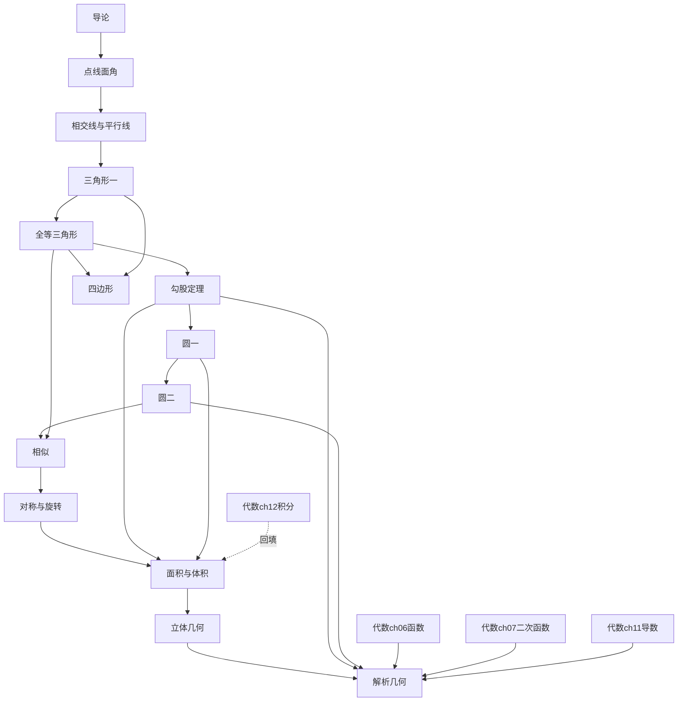

# 数学 · 几何课程体系（绿队设计 v1.0）

> 设计原则：
> 1. **零起点**：不假设任何前置几何知识，每课前置可追溯到本体系内或小学算术。
> 2. **数形结合是铁律**：每个概念必须有图形载体；凡能用图形动画演示的证明，不用纯文字证明。
> 3. **严谨性**：概念引入顺序不可逆，无循环定义；代数体系的已有结论可直接引用（标注代数章节），不再重证。
> 4. **与代数互补**：几何是对代数的充分补充——代数用"数"讲清了结构，几何用"形"把同样的结构看得见、摸得着。
>
> 难度标记：★入门 ★★基础 ★★★进阶 ★★★★高阶
> 课时：每课约 30–45 分钟（含交互动画探索）
> 口径：课 = 教学单元；页 = 一屏页面（参考代数生产实际：每课 1 交互页 + 2 讲解页，平均约 2.5 页/课）
>
> 章编号用 `g00`–`g13`（与代数 `ch00`–`ch12` 区分），数据文件拟为 `modules/math/data/gNN.js`。

---

## 总览

| 章 | 章名 | 单元数 | 课数 | 难度 | 预估页数 |
|----|------|--------|------|------|----------|
| g00 | 导论——几何是什么 | 1 | 4 | ★ | 10 |
| g01 | 点、线、面、角 | 2 | 8 | ★ | 20 |
| g02 | 相交线与平行线 | 2 | 8 | ★★ | 20 |
| g03 | 三角形（一）：认识三角形 | 1 | 6 | ★★ | 15 |
| g04 | 全等三角形 | 1 | 8 | ★★ | 20 |
| g05 | 勾股定理 | 1 | 8 | ★★★ | 20 |
| g06 | 四边形 | 1 | 7 | ★★ | 18 |
| g07 | 圆（一）：圆的基本性质 | 1 | 7 | ★★★ | 18 |
| g08 | 圆（二）：切线与圆的方程 | 1 | 7 | ★★★ | 18 |
| g09 | 图形的相似 | 1 | 8 | ★★★ | 20 |
| g10 | 图形的变换：对称与旋转 | 1 | 8 | ★★ | 20 |
| g11 | 面积与体积 | 1 | 10 | ★★ | 25 |
| g12 | 立体几何初步 | 1 | 6 | ★★★ | 15 |
| g13 | 解析几何入门 | 1 | 10 | ★★★★ | 25 |
| — | **合计** | **15** | **105** | — | **约 264** |

> 页数口径：105 课 × 约 2.5 页/课 ≈ 264 页（含每章末习题页）。与代数（108 课 / 273 页）体量相当，互补成套。

---

## 第零章：导论——几何是什么

**难度**：★入门 | **预计**：4 课时 | **目标**：建立"几何是研究形状、大小、位置的学问"的直觉，点明与代数的握手关系

### 单元 g00.1 几何的直觉

| 课名 | 核心概念 | 关键定理/结论 | 图形直观（动画点） | 前置 |
|------|----------|---------------|--------------------|------|
| g00.1.1 几何是什么：从丈量土地说起 | 几何源于测量；形状、大小、位置 | ——（历史与直观） | 尼罗河泛滥后重新丈量土地的示意图 | 小学算术 |
| g00.1.2 点、线、面、体：维度的直觉 | 点动成线、线动成面、面动成体；维度 | ——（直观） | 点拉出线、线扫出面、面堆出体的连续动画 | 几何是什么 |
| g00.1.3 图形会说话：直观证明 | 拼图即证明的思想 | 三角形内角和拼图（预告 g03） | 三个角撕下拼成平角的动画 | 维度的直觉 |
| g00.1.4 几何与代数的握手 | 数形结合：同一个规律，两种语言 | x² 既是代数式又是正方形面积（预告） | 正方形边长拖动，面积数值同步变化 | 图形会说话 |

---

## 第一章：点、线、面、角

**难度**：★入门 | **预计**：8 课时 | **目标**：掌握几何最基本的语言：点、线、角的表示与度量

### 单元 g01.1 点与线

| 课名 | 核心概念 | 关键定理/结论 | 图形直观（动画点） | 前置 |
|------|----------|---------------|--------------------|------|
| g01.1.1 点、线、面的概念 | 点、直线、平面的表示 | ——（定义） | 生活中的点线面实例图 | 导论 |
| g01.1.2 直线、射线、线段 | 三种线的区别与表示 | **两点确定一条直线** | 过两点画直线：转动画笔只有一条能同时穿过 | 点线面的概念 |
| g01.1.3 线段的比较与中点 | 线段长短比较、中点、线段的和差 | 两点之间线段最短 | 叠合法比较动画；弯路 vs 直路 | 直线射线线段 |

### 单元 g01.2 角

| 课名 | 核心概念 | 关键定理/结论 | 图形直观（动画点） | 前置 |
|------|----------|---------------|--------------------|------|
| g01.2.1 角的概念与表示 | 角的定义、表示法（∠AOB） | 周角=360°、平角=180° | 射线绕端点旋转形成角的动画 | 线段的比较与中点 |
| g01.2.2 角的度量 | 度、分、秒；量角器 | 1°=60′，1′=60″ | 量角器测量动画 | 角的概念与表示 |
| g01.2.3 角的比较与角平分线 | 角的和差、角平分线 | 角平分线把角分成两个相等的角 | 对折纸张得到角平分线 | 角的度量 |
| g01.2.4 余角与补角 | 互余、互补 | **同角（等角）的余角相等；同角（等角）的补角相等** | 直角/平角中"缺一块"的拼图 | 角的比较与角平分线 |
| g01.2.5 本章小结与习题 | —— | —— | —— | 全章 |

---

## 第二章：相交线与平行线

**难度**：★★基础 | **预计**：8 课时 | **目标**：掌握对顶角、垂线、平行线的判定与性质；第一次接触"图形的运动"（平移）

### 单元 g02.1 相交线

| 课名 | 核心概念 | 关键定理/结论 | 图形直观（动画点） | 前置 |
|------|----------|---------------|--------------------|------|
| g02.1.1 对顶角与邻补角 | 对顶角、邻补角 | **对顶角相等**（用补角性质证明，动画演示） | 两直线相交，四角此消彼长的动画 | 余角与补角 |
| g02.1.2 垂线 | 垂直的定义、垂线的画法 | 过一点有且只有一条直线与已知直线垂直 | 三角板推动画出垂线 | 对顶角与邻补角 |
| g02.1.3 点到直线的距离 | 垂线段、距离 | **垂线段最短** | 点向直线"跳"：斜线段 vs 垂线段长度对比 | 垂线 |
| g02.1.4 同位角、内错角、同旁内角 | 三线八角 | "F/Z/U" 形辨认法 | 第三条直线切割两直线，八个角逐个点亮 | 点到直线的距离 |

### 单元 g02.2 平行线

| 课名 | 核心概念 | 关键定理/结论 | 图形直观（动画点） | 前置 |
|------|----------|---------------|--------------------|------|
| g02.2.1 平行的定义与平行公理 | 平行、平行公理 | 过直线外一点有且只有一条直线与之平行 | 铁轨永不相交的直观 | 三线八角 |
| g02.2.2 平行线的判定 | 三种判定方法 | 同位角相等/内错角相等/同旁内角互补→两直线平行 | 量角器验证：角相等时直线"果然"平行 | 平行的定义与平行公理 |
| g02.2.3 平行线的性质 | 三种性质 | 两直线平行→同位角/内错角相等、同旁内角互补 | 平行线被截，三种角的度数联动 | 平行线的判定 |
| g02.2.4 平移：图形的第一次运动 | 平移的定义与性质 | 对应点连线平行且相等；平移不改变形状大小 | 三角形沿箭头滑动，留下对应点连线 | 平行线的性质 |
| g02.2.5 本章小结与习题 | —— | —— | —— | 全章 |

---

## 第三章：三角形（一）——认识三角形

**难度**：★★基础 | **预计**：6 课时 | **目标**：掌握三角形的三边关系、内角和，学会用平行线证明内角和

### 单元 g03.1 三角形的基础

| 课名 | 核心概念 | 关键定理/结论 | 图形直观（动画点） | 前置 |
|------|----------|---------------|--------------------|------|
| g03.1.1 三角形的定义与三边关系 | 三角形的表示、边角顶点 | **三角形两边之和大于第三边**（由"两点之间线段最短"推出） | 三根小棒拼三角形：太短的两根"够不着" | 平移 |
| g03.1.2 三角形的分类与三线 | 按边/角分类；高、中线、角平分线 | 钝角三角形的高在形外 | 高、中线、角平分线三线同图的区分动画 | 三角形的定义与三边关系 |
| g03.1.3 三角形内角和 | 内角和 180° | **三角形内角和等于 180°**（拼图+平行线证明） | 撕角拼成平角；过顶点作平行线的规范证明动画 | 三角形的分类与三线 |
| g03.1.4 三角形的外角 | 外角、外角和 | **外角等于不相邻两内角之和** | 外角"张开"的过程动画 | 三角形内角和 |
| g03.1.5 多边形的内角和 | n 边形内角和 | **(n−2)×180°**（从一个顶点引对角线分成 n−2 个三角形） | 对角线剖分多边形的动画 | 三角形的外角 |
| g03.1.6 本章小结与习题 | —— | —— | —— | 全章 |

---

## 第四章：全等三角形

**难度**：★★基础 | **预计**：8 课时 | **目标**：掌握全等的四种判定（SSS/SAS/ASA/AAS），理解等腰三角形的对称性，学会基本尺规作图

### 单元 g04.1 全等与判定

| 课名 | 核心概念 | 关键定理/结论 | 图形直观（动画点） | 前置 |
|------|----------|---------------|--------------------|------|
| g04.1.1 全等的概念 | 全等形、对应边、对应角 | 全等三角形的对应边相等、对应角相等 | 两个三角形重合的拖拽动画 | 多边形的内角和 |
| g04.1.2 SSS 判定 | 边边边 | **三边对应相等→全等**（三角形具有稳定性） | 拉动四边形变形 vs 三角形纹丝不动 | 全等的概念 |
| g04.1.3 SAS 判定 | 边角边 | **两边及夹角对应相等→全等** | 两边夹角固定，三角形形状被"锁死" | SSS 判定 |
| g04.1.4 ASA 与 AAS 判定 | 角边角、角角边 | **两角及一边对应相等→全等** | 两角一夹边扫出唯一三角形 | SAS 判定 |
| g04.1.5 等腰三角形的性质 | 等边对等角、三线合一 | **等腰三角形两底角相等；顶角平分线、底边中线、底边高重合** | 对折等腰三角形完全重合的动画 | ASA 与 AAS 判定 |
| g04.1.6 等腰三角形的判定与等边三角形 | 等角对等边 | **两角相等→等腰；三边相等/三角 60°→等边** | ——（性质的逆向） | 等腰三角形的性质 |
| g04.1.7 尺规作图（一） | 作线段、作角、作角平分线、作垂线 | 作图即全等判定（SSS/SAS）的应用 | 圆规直尺一步步作图的动画 | 等腰三角形的判定 |
| g04.1.8 本章小结与习题 | —— | —— | —— | 全章 |

> 注：直角三角形的 HL 判定需勾股定理，放在 g05.1.5（几何体系内唯一的"后置补判定"，已在依赖图中标明）。

---

## 第五章：勾股定理

**难度**：★★★进阶 | **预计**：8 课时 | **目标**：理解勾股定理的发现、证明与应用；得到两点间距离公式（代数与几何的第一次正式握手）

> 本章是几何体系承上启下的枢纽：向上承接全等，向下支撑圆、相似、解析几何；同时是呼应代数最多的章节。

### 单元 g05.1 勾股定理

| 课名 | 核心概念 | 关键定理/结论 | 图形直观（动画点） | 前置 |
|------|----------|---------------|--------------------|------|
| g05.1.1 发现：方格纸上的秘密 | 勾股关系 a²+b²=c² | 直角三角形两直角边平方和等于斜边平方（猜想） | 方格纸上数三个正方形的格子数 | 等腰三角形的判定（g04） |
| g05.1.2 证明：弦图拼图 | 赵爽弦图 | **勾股定理**：a²+b²=c²（面积拼图证明） | 四个直角三角形拼合，大正方形面积两种算法 | 发现 |
| g05.1.3 应用：已知两边求第三边 | 直接应用 | ——（计算） | 梯子靠墙、旗杆拉绳等实例图 | 证明 |
| g05.1.4 逆定理：判定直角三角形 | 勾股逆定理 | **a²+b²=c²→直角三角形**（用 SSS 构造全等证明） | 3-4-5 绳圈拉成直角（古埃及绳法） | 应用 |
| g05.1.5 HL：直角三角形全等 | 斜边直角边 | **斜边和一条直角边对应相等→全等**（勾股定理+SSS） | 补全 g04 的最后一块拼图 | 逆定理、SSS（g04） |
| g05.1.6 两点间距离公式 | 数轴距离→平面距离 | **d=√[(x₂−x₁)²+(y₂−y₁)²]**（构造直角三角形用勾股定理） | 坐标系中两点连出"横平竖直"的直角三角形 | HL（本章内） |
| g05.1.7 勾股数 | 常见勾股数（3-4-5 等） | ——（数感） | 整数边直角三角形的家族图谱 | 两点间距离公式 |
| g05.1.8 本章小结与习题 | —— | —— | —— | 全章 |

> **与代数呼应**：g05.1.2 的弦图是代数 2.2.2 完全平方公式几何证明的"姊妹篇"；g05.1.6 的距离公式是代数体系的几何地基（代数 ch06 坐标系、ch13 解析几何入口）；√2 的几何意义（正方形对角线）回填代数 0.1.3 无理数的几何构造。

---

## 第六章：四边形

**难度**：★★基础 | **预计**：7 课时 | **目标**：掌握平行四边形、矩形、菱形、正方形、梯形的性质与判定，理解"一般→特殊"的分类思想

### 单元 g06.1 四边形家族

| 课名 | 核心概念 | 关键定理/结论 | 图形直观（动画点） | 前置 |
|------|----------|---------------|--------------------|------|
| g06.1.1 平行四边形的性质 | 对边平行相等、对角相等、对角线互相平分 | **平行四边形对角线互相平分**等（用全等证明） | 对角线交点旋转 180° 重合 | 全等判定（g04） |
| g06.1.2 平行四边形的判定 | 四种判定方法 | 两组对边分别平行/相等、一组平行且相等、对角线互相平分 | 用判定条件"拼出"平行四边形 | 平行四边形的性质 |
| g06.1.3 矩形 | 定义、四个角是直角、对角线相等 | **矩形的对角线相等且互相平分** | 平行四边形"拉直"成矩形的连续变形 | 平行四边形的判定 |
| g06.1.4 菱形 | 定义、四边相等、对角线垂直平分 | **菱形的对角线互相垂直平分** | 平行四边形"压扁/拉长"成菱形 | 矩形 |
| g06.1.5 正方形 | 矩形+菱形 | 正方形兼具矩形与菱形的一切性质 | 家族谱系图：四边形→平行四边形→矩形/菱形→正方形 | 菱形 |
| g06.1.6 梯形与三角形中位线 | 梯形、等腰梯形、中位线 | **三角形中位线平行于第三边且等于其一半** | 中位线把三角形"切"出小三角形的动画 | 正方形 |
| g06.1.7 本章小结与习题 | —— | —— | —— | 全章 |

---

## 第七章：圆（一）——圆的基本性质

**难度**：★★★进阶 | **预计**：7 课时 | **目标**：掌握垂径定理、圆心角与圆周角的关系，体会圆的对称性

### 单元 g07.1 圆的对称性与角

| 课名 | 核心概念 | 关键定理/结论 | 图形直观（动画点） | 前置 |
|------|----------|---------------|--------------------|------|
| g07.1.1 圆的基本概念 | 圆心、半径、弦、直径、弧、半圆 | 同圆（等圆）半径相等；直径是最大的弦 | 圆规画圆：到定点距离等于定长的点的轨迹 | 勾股定理（g05） |
| g07.1.2 垂径定理 | 垂直于弦的直径 | **垂直于弦的直径平分弦、平分弦所对的弧**（圆的轴对称性） | 直径为轴对折，弦的两半重合 | 圆的基本概念 |
| g07.1.3 弧、弦、圆心角 | 圆心角、等弧 | **等弧对等弦、等弦对等圆心角**（旋转不变性） | 圆心角旋转，弧弦联动 | 垂径定理 |
| g07.1.4 圆周角（一）：定义 | 圆周角 | 顶点在圆上、两边交圆 | 圆周角 vs 圆心角的对比图 | 弧弦圆心角 |
| g07.1.5 圆周角（二）：圆周角定理 | 圆周角定理 | **同弧所对的圆周角等于圆心角的一半**（三种位置分类动画证明） | 圆心在角内/角上/角外的三种情形 | 圆周角定义 |
| g07.1.6 推论：直径所对的圆周角 | 直角推论 | **直径所对的圆周角是直角；90° 圆周角对直径** | 半圆上的角恒为直角（拖动顶点验证） | 圆周角定理 |
| g07.1.7 本章小结与习题 | —— | —— | —— | 全章 |

---

## 第八章：圆（二）——切线与圆的方程

**难度**：★★★进阶 | **预计**：7 课时 | **目标**：掌握切线的判定与性质；第一次写出圆的代数方程（x²+y²=r²），为解析几何铺路

### 单元 g08.1 位置关系与切线

| 课名 | 核心概念 | 关键定理/结论 | 图形直观（动画点） | 前置 |
|------|----------|---------------|--------------------|------|
| g08.1.1 点与圆的位置关系 | 点在圆内/上/外 | d<r / d=r / d>r（d 为点到圆心距离） | 点向圆靠近，距离数值与位置联动 | 圆周角推论（g07） |
| g08.1.2 直线与圆的位置关系 | 相交、相切、相离 | d<r / d=r / d>r（d 为圆心到直线距离） | 直线平移靠近圆：割线→切线→相离 | 点与圆的位置关系 |
| g08.1.3 切线的判定与性质 | 切线 | **经过半径外端且垂直于半径的直线是切线；切线垂直于过切点的半径** | 半径"转"到与直线垂直即相切 | 直线与圆的位置关系 |
| g08.1.4 切线长定理 | 切线长 | **从圆外一点引两条切线，切线长相等**（用 HL 证明） | 两条切线对称的镜像动画 | 切线的判定与性质 |
| g08.1.5 三角形的外接圆与内切圆 | 外心、内心 | 外心是三边垂直平分线交点；内心是三角平分线交点 | 三角形"套"进圆 / 圆"塞"进三角形的动画 | 切线长定理 |
| g08.1.6 圆的方程：x²+y²=r² | 圆的代数表示 | **到原点距离为 r 的点满足 x²+y²=r²**（距离公式+勾股定理） | 圆上动点坐标实时显示满足方程 | 外接圆与内切圆、距离公式（g05） |
| g08.1.7 本章小结与习题 | —— | —— | —— | 全章 |

> **与代数呼应**：g08.1.6 是代数 6.2（一次函数图像）之后"方程→图形"的第二个里程碑：圆既是几何图形又是二元二次方程，为 g13 解析几何正式开讲埋好引线。

---

## 第九章：图形的相似

**难度**：★★★进阶 | **预计**：8 课时 | **目标**：掌握相似三角形的判定与性质，理解"形状相同、大小成比例"，学会用相似解决测量问题

### 单元 g09.1 相似

| 课名 | 核心概念 | 关键定理/结论 | 图形直观（动画点） | 前置 |
|------|----------|---------------|--------------------|------|
| g09.1.1 比例线段与黄金分割 | 成比例线段、黄金比 | a:b=b:c；黄金比 ≈0.618 | 线段按比例分割的动画；生活中的黄金分割实例 | 圆的方程（g08） |
| g09.1.2 相似图形 | 相似多边形 | 对应角相等、对应边成比例 | 照片放大缩小的动画 | 比例线段 |
| g09.1.3 相似三角形的判定（一）：AA | 两角对应相等 | **两角对应相等→相似**（与 ASA 全等类比） | 全等是相似比为 1 的特例 | 相似图形、全等（g04） |
| g09.1.4 判定（二）：SAS/SSS | 两边成比例夹角相等 / 三边成比例 | 类比 SAS/SSS 全等判定 | 全等判定表 vs 相似判定表对照 | AA 判定 |
| g09.1.5 相似三角形的性质 | 周长比、面积比 | **周长比=相似比；面积比=相似比的平方** | 相似比拖动，周长/面积数值联动 | SAS/SSS 判定 |
| g09.1.6 应用：测高与测距 | 影子测高、标杆测距 | ——（建模） | 太阳光线平行→相似三角形测旗杆 | 相似三角形的性质 |
| g09.1.7 位似 | 位似中心、位似比 | 位似是特殊的相似；对应点连线交于位似中心 | 以一点为中心放大图形的动画 | 应用 |
| g09.1.8 本章小结与习题 | —— | —— | —— | 全章 |

> **与代数呼应**：g09.1.5"面积比=相似比的平方"是二次关系的几何化身，与代数 7.1（二次函数 y=ax²）互相印证：边长变 k 倍，面积变 k² 倍。

---

## 第十章：图形的变换——对称与旋转

**难度**：★★基础 | **预计**：8 课时 | **目标**：掌握轴对称、中心对称、旋转的性质；用"运动的眼光"重新理解全等（全等即运动重合）

> 平移已在 g02.2.4 讲过，本章补齐三大变换的后两块，形成完整拼图。

### 单元 g10.1 对称与旋转

| 课名 | 核心概念 | 关键定理/结论 | 图形直观（动画点） | 前置 |
|------|----------|---------------|--------------------|------|
| g10.1.1 轴对称的概念 | 轴对称、对称轴 | ——（定义） | 蝴蝶、剪纸的对折动画 | 位似（g09） |
| g10.1.2 轴对称的性质 | 对称点连线被对称轴垂直平分 | **对称轴是对应点连线的垂直平分线** | 翻折前后对应点连线与折痕的关系 | 轴对称的概念 |
| g10.1.3 作轴对称图形 | 尺规/方格纸作图 | ——（作图） | 方格纸上"照镜子"画图 | 轴对称的性质 |
| g10.1.4 等腰三角形的对称性再探 | 对称视角看等腰三角形 | 三线合一即对称轴（回看 g04.1.5） | 等腰三角形沿对称轴翻折完全重合 | 作轴对称图形 |
| g10.1.5 中心对称 | 中心对称、对称中心 | **中心对称即旋转 180°**；平行四边形是中心对称图形 | 图形绕一点转半圈重合 | 等腰三角形的对称性 |
| g10.1.6 旋转 | 旋转中心、旋转角 | 对应点到旋转中心距离相等 | 时针、分针的旋转动画 | 中心对称 |
| g10.1.7 旋转与全等：运动的眼光 | 全等的运动本质 | **平移/轴对称/旋转都不改变形状大小；全等即经运动可重合** | 三角形经三种运动与原图重合 | 旋转 |
| g10.1.8 本章小结与习题 | —— | —— | —— | 全章 |

---

## 第十一章：面积与体积

**难度**：★★基础 | **预计**：10 课时 | **目标**：掌握常用平面图形面积与立体图形表面积/体积；用"割补"与"极限"两种思想统一面积公式；呼应代数的微积分思想

### 单元 g11.1 面积

| 课名 | 核心概念 | 关键定理/结论 | 图形直观（动画点） | 前置 |
|------|----------|---------------|--------------------|------|
| g11.1.1 矩形与正方形的面积 | 面积单位、S=ab、S=a² | **正方形面积 = 边长的平方**（x² 的几何化身） | 边长拖动，方格数=a² 联动 | 旋转与全等（g10） |
| g11.1.2 平行四边形面积 | S=ah | **等底等高的平行四边形面积相等**（割补法） | 平行四边形"剪一刀拼成矩形" | 矩形面积 |
| g11.1.3 三角形面积 | S=ah/2 | 两个全等三角形拼成平行四边形 | 三角形复制翻转拼成平行四边形 | 平行四边形面积 |
| g11.1.4 梯形面积 | S=(a+b)h/2 | 两个全等梯形拼成平行四边形 | 梯形复制旋转拼接 | 三角形面积 |
| g11.1.5 圆的面积：化圆为方 | S=πr² | **圆面积 = πr²**（割圆为细扇形拼成近似矩形，份数越多越精确） | 扇形份数从 8 到 128 渐变成矩形的极限动画 | 梯形面积、圆（g07） |
| g11.1.6 弧长与扇形面积 | l=nπr/180、S=nπr²/360 | 弧长/扇形面积与圆心角成正比 | 圆心角拖动，扇形"吃掉"圆的一部分 | 圆的面积 |
| g11.1.7 柱体的表面积与体积 | 棱柱、圆柱 | **V=Sh**（底面积×高）；表面积=展开图面积 | 圆柱侧面展开成矩形的动画 | 弧长与扇形面积 |
| g11.1.8 锥体的体积 | 圆锥、棱锥 | **V=Sh/3**（等底等高柱体体积的三分之一） | 沙漏实验：三杯锥体沙恰好装满柱体 | 柱体体积 |
| g11.1.9 球的表面积与体积 | S=4πr²、V=4πr³/3 | ——（结论+直观，证明需积分，设回填点） | 球的"橘子瓣"展开近似 | 锥体体积 |
| g11.1.10 本章小结与习题 | —— | —— | —— | 全章 |

> **与代数呼应**：
> - g11.1.1：x²=正方形面积（代数 2.2.2、4.0.1 的几何地基）；配方法"补正方形"（代数 4.1.2）的图形即本章割补思想的亲戚。
> - g11.1.5：割圆术是"分割→近似→取极限"（代数 12.1.1 曲边梯形面积）的几何预演；学生先在图形上看到极限，再在代数里算出极限。
> - g11.1.9：球体积的严格推导需定积分，回填点设在学完代数第十二章之后（附录 B）。

---

## 第十二章：立体几何初步

**难度**：★★★进阶 | **预计**：6 课时 | **目标**：建立空间观念：认识常见立体图形，理解空间中的平行与垂直，学会三视图与展开图

> 本章以直观为主、证明为辅（严格的空间位置关系证明超出自学范围，点到为止）。

### 单元 g12.1 走进立体图形

| 课名 | 核心概念 | 关键定理/结论 | 图形直观（动画点） | 前置 |
|------|----------|---------------|--------------------|------|
| g12.1.1 认识立体图形 | 棱柱、棱锥、圆柱、圆锥、球；棱、顶点 | 欧拉公式 V−E+F=2（观察发现，不证明） | 旋转展示各类立体图形 | 球的体积（g11） |
| g12.1.2 空间中的平行与垂直 | 直线与平面平行/垂直的直观 | 长方体中找平行/垂直（直观判断） | 长方体棱的高亮：这组平行、这组垂直 | 认识立体图形 |
| g12.1.3 三视图 | 主视图、左视图、俯视图 | 长对正、高平齐、宽相等 | 立体图形旋转，对应三视图同步生成 | 空间平行垂直 |
| g12.1.4 展开图 | 表面展开 | 正方体 11 种展开图（"一四一"等口诀） | 正方体"剥开"成立体→平面的动画 | 三视图 |
| g12.1.5 截面 | 平面截立体图形 | 用平面截正方体可得三角形/四边形/五边形/六边形 | 切西瓜动画：截面形状随切割角度变化 | 展开图 |
| g12.1.6 本章小结与习题 | —— | —— | —— | 全章 |

---

## 第十三章：解析几何入门

**难度**：★★★★高阶 | **预计**：10 课时 | **目标**：用坐标与方程统一几何：直线、圆、抛物线的代数表示；看到"切线斜率=导数"，完成几何与代数的终极握手

> 本章是全体系的收官：所有几何直观在此与代数工具汇合。前置横跨几何与代数两大体系，见依赖图。

### 单元 g13.1 用代数研究几何

| 课名 | 核心概念 | 关键定理/结论 | 图形直观（动画点） | 前置 |
|------|----------|---------------|--------------------|------|
| g13.1.1 坐标系：几何视角 | 有序数对表示点 | 点↔坐标一一对应（代数 6.1 已建，此处换几何视角） | 点在坐标系中移动，坐标实时显示 | 三视图（g12）、代数 6.1 |
| g13.1.2 两点间距离公式 | d=√[(x₂−x₁)²+(y₂−y₁)²] | ——（g05.1.6 已证，此处作为工具使用） | ——（引用） | g05.1.6 |
| g13.1.3 中点公式 | ((x₁+x₂)/2, (y₁+y₂)/2) | 中点坐标是端点坐标的平均 | 线段中点拖动验证 | 距离公式 |
| g13.1.4 直线的倾斜角与斜率 | 斜率 k=Δy/Δx | **k=tanθ**；k>0 上坡、k<0 下坡 | 直线旋转，斜率数值联动 | 中点公式、代数 6.2 |
| g13.1.5 直线方程 | 点斜式、斜截式 y=kx+b | **y=kx+b 中 k 是斜率、b 是截距**（代数 6.2.2 的几何正名） | k、b 滑块控制直线 | 斜率 |
| g13.1.6 两直线的位置关系 | 平行/垂直的斜率条件 | **k₁=k₂→平行；k₁k₂=−1→垂直**（垂直用勾股定理证明） | 两直线拖动，k₁k₂ 乘积恒为 −1 的验证 | 直线方程、勾股定理（g05） |
| g13.1.7 抛物线的几何定义 | 焦点、准线 | **到焦点与准线等距的轨迹是抛物线**；化简得 y=ax²（呼应代数 7.1） | 焦点/准线拖动，抛物线形状联动；几何定义→代数方程的推导动画 | 直线方程、代数 7.1 |
| g13.1.8 圆的方程 | (x−a)²+(y−b)²=r² | ——（g08.1.6 的平移推广） | 圆心拖动，方程参数联动 | 抛物线、g08.1.6 |
| g13.1.9 切线斜率与导数 | 切线斜率即导数 | **圆上一点的切线斜率 = 该点处"变化率"**；一般曲线的切线斜率就是导数 f′(x₀)（代数 11.1.3 的几何回声） | 割线→切线的极限动画（与代数 11.1.2 同一动画的几何版） | 圆的方程、代数 11.1 |
| g13.1.10 全书总结：数与形的统一 | —— | 几何问题↔代数问题互译；全书知识图谱 | 几何与代数双体系汇合图 | 全体系 |

---

## 前置依赖关系图

**依赖说明**：
1. 主链：g00→g01→g02→g03→g04→g05→g07→g08→g09→g10→g11→g12→g13，无环。
2. g06（四边形）挂在 g04/g03 之后，与 g05 并行，可与 g05 同步学习。
3. g05.1.5（HL）是全体系唯一的"前向引用回填"：g04 讲全等判定时预告"直角三角形还有第五种判定，学完勾股定理揭晓"，g05.1.5 兑现。有向无环（g04→g05），不构成循环依赖。
4. 跨体系依赖（几何→代数）均为单向引用已完成的代数章节：g13 引用代数 ch06/ch07/ch11；g11.1.9 回填点依赖代数 ch12。不存在代数→几何的反向依赖（代数体系 v2.0 已完备），故双体系整体无环。
5. 代数 8.3（三角函数初探）与几何的关系：几何体系内**不引入三角函数**（正弦定理、余弦定理、海伦公式等有意留白，作为几何 v2.0 / 三角模块的扩展口），避免与代数 8.3 的"初探"定位冲突。

---

## 与代数的呼应点总表

| # | 几何位置 | 代数位置 | 呼应内容 | 呼应方式 |
|---|----------|----------|----------|----------|
| 1 | g05.1.2 弦图证明 | ch02 2.2.2 完全平方公式 | 同一个拼图，既证勾股定理又证 (a+b)² | 双向印证 |
| 2 | g05.1.6/g13.1.2 距离公式 | ch06 坐标系 | 勾股定理长出代数工具 | 几何→代数输送 |
| 3 | g08.1.6/g13.1.8 圆的方程 | ch06 6.2 一次函数图像 | "方程↔图形"的第二个里程碑 | 概念升级 |
| 4 | g09.1.5 面积比=相似比² | ch07 7.1 二次函数 | 二次关系的几何化身 | 双向印证 |
| 5 | g11.1.1 正方形面积=a² | ch02 2.2.2、ch04 4.0.1/4.1.2 | x² 的几何地基；配方法=补正方形 | 几何为代数奠基 |
| 6 | g11.1.5 割圆术 | ch12 12.1.1 曲边梯形面积 | 分割→近似→极限的几何预演 | 几何先行、代数跟进 |
| 7 | g13.1.5 直线方程 | ch06 6.2.2 一次函数 | k、b 的几何正名 | 双向印证 |
| 8 | g13.1.7 抛物线几何定义 | ch07 7.1 二次函数图像 | 同一条抛物线，两种定义方式 | 双向印证 |
| 9 | g13.1.9 切线斜率 | ch11 11.1.2/11.1.3 导数 | 割线→切线极限动画的几何版；导数几何意义的回声 | 终极握手 |
| 10 | g00.1.4 / g13.1.10 | 全书 | 数形结合的方法论首尾呼应 | 方法论闭环 |

---

## 页数预估明细

| 章 | 课数 | 交互页 | 讲解页（估算） | 习题页 | 小计 |
|----|------|--------|---------------|--------|------|
| g00 | 4 | 4 | 5 | 1 | 10 |
| g01 | 8 | 8 | 10 | 2 | 20 |
| g02 | 8 | 8 | 10 | 2 | 20 |
| g03 | 6 | 6 | 7 | 2 | 15 |
| g04 | 8 | 8 | 10 | 2 | 20 |
| g05 | 8 | 8 | 10 | 2 | 20 |
| g06 | 7 | 7 | 9 | 2 | 18 |
| g07 | 7 | 7 | 9 | 2 | 18 |
| g08 | 7 | 7 | 9 | 2 | 18 |
| g09 | 8 | 8 | 10 | 2 | 20 |
| g10 | 8 | 8 | 10 | 2 | 20 |
| g11 | 10 | 10 | 13 | 2 | 25 |
| g12 | 6 | 6 | 7 | 2 | 15 |
| g13 | 10 | 10 | 13 | 2 | 25 |
| **合计** | **105** | **105** | **约 132** | **约 27** | **约 264** |

> 口径说明：每课 1 交互页（schema 要求 interaction 必填）+ 平均 1.25 讲解页 + 每章约 2 页习题（含小结）。几何的图形密度高于代数，讲解页按 1.25/课估算；实际生产中证明类课程（如 g05.1.2、g07.1.5）可能需要 2–3 讲解页，届时以白队 QA 为准微调。

---

## 附录 A：严谨性检查清单（绿队自查 v1.0）

1. ✅ 点线面角在相交线之前（g01 → g02）
2. ✅ 平行线性质先于三角形内角和证明（g02.2.3 → g03.1.3）
3. ✅ 全等判定先于其一切应用：平行四边形性质（g06）、勾股逆定理（g05.1.4）、切线长定理（g08.1.4）
4. ✅ SSS/SAS/ASA/AAS 先于 HL（g04 → g05.1.5，HL 明确后置）
5. ✅ 勾股定理先于：垂径定理的应用、距离公式、圆的方程、两直线垂直的斜率条件
6. ✅ 圆的基本性质先于切线（g07 → g08）
7. ✅ 全等先于相似（g04 → g09），且相似判定与全等判定明确类比、不混淆
8. ✅ 面积公式链：矩形 → 平行四边形 → 三角形 → 梯形 → 圆（割补思想单向推进）
9. ✅ 柱体体积先于锥体体积（g11.1.7 → g11.1.8，1/3 关系依赖柱体）
10. ✅ 平面几何完备后才进入立体（g11 → g12）
11. ✅ 解析几何压轴，前置全部平面几何与所需代数章节（g13.1.10，前置全体系）
12. ✅ 无循环定义：每个概念的前置链可追溯到 g00 或小学算术（g05.1.5 HL 回填、g11.1.9 球体积回填为例外，已设回填点）
13. ✅ 数形结合全覆盖：除小结习题课外，每课有明确图形直观/动画点
14. ✅ 与代数体系整体无环：几何单向引用代数，代数不反向依赖几何

## 附录 B：回填点清单

| 位置 | 内容 | 回填时机 |
|------|------|----------|
| g05.1.5 | HL 判定（g04 预告） | g05 章内兑现 |
| g11.1.9 | 球体积/表面积的严格推导（需定积分） | 学完代数 ch12 之后 |
| （扩展口） | 正弦定理、余弦定理、海伦公式、三角函数深入 | 几何 v2.0 或独立三角模块，不在 v1.0 范围 |

## 附录 C：有意留白（v1.0 不做的内容）

1. **三角函数**：代数 8.3 已做"初探"；几何 v1.0 不引入 sin/cos 解三角形，避免与代数定位冲突。正弦/余弦定理留给 v2.0。
2. **严格的立体几何证明**：g12 以直观为主，空间平行/垂直的判定定理证明超出自学友好范围，点到为止。
3. **圆锥曲线深入**：g13 只到抛物线几何定义与圆的方程；椭圆、双曲线留给 v2.0。
4. **向量**：平面向量的代数化是解析几何的自然延伸，v1.0 不引入，v2.0 可与复数/三角模块联动。

---

**统计**：14 章（g00–g13）/ 15 单元 / **105 课** / 约 264 页 / 预计 55–80 小时
