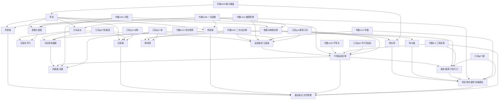

# 物理 · 课程体系（物理专家队设计 v1.1）

## 修订记录

### v1.1（2026-10-14）

两轮对抗评审 accepted 修补落实（物理专家队 + 黄队 + 蓝白队三方）：

1. **p08.2.3 欧姆定律**：知识点改为"I–U 图像探究 + I–R 定性（R 越大 I 越小，不画双曲线）"；数学呼应加注"回填：反比例图像等代数 7.2 学完后回填"。
2. **p04.1.2 密度**：增加"斜率直观版"一页（线的倾斜程度——越陡越大，不讲正比例函数定义），页数 3→4。
3. **p13.2.1 圆周运动**：知识点加注"自带'弧度制一页通'（角度→弧度一页讲透）；待代数 8.3 内容清单核查后再决定是否删除"。
4. **p06.1.3 大气压强**：常见误区改为"大气压随高度、天气变化（高山上水不到 100℃ 就开）；760mmHg 是'标准大气压'的定义值，恒成立"。
5. **p11.2.2 v-t 图像**：页数 3→4；总页数 338→340（总览/明细/口径/统计全书同步）；p08.1.2 加注"讲解页内设'电流方向'独立区块（半页，不单独成课）"；p12.2.1 加注"讲解页开头设'认旧友'段回填牛顿第一定律（不单独成页）"。
6. **p02.1.3 平面镜成像**：加注"自带'轴对称一页直观版'（对折重合，不讲理论）"；数学呼应改为"回填：学完几何 g10 后回填认旧友"。
7. **轻微项**：p01.1.3 数学呼应加注"只看波形、不出现'正弦'术语（预告）"；数学呼应列全书凡涉及时序的加注"预告/回填/奠基"标签；p14.1.2 常见误区改为"W合漏力 / 动能定理与机械能守恒混用"；课时口径改为"40–60 分钟/课（不含习题页时间）"；p06.1.1 反比例呼应加注"定性，不画双曲线图像"；p11.1.3 删掉牵强的"代数 8.3（Δv 矢量差）"呼应；p03.1.1 误区标签改为"思想点（热平衡）"；p08.1.3 改表述为"并联互不影响的前提：电压相同"。

> **物理专家队定位**：类比数学绿队（数学家）的学科专家队，专职抓物理根本错误——概念偷换、公式滥用、量纲混乱、矢量标量混淆、理想模型边界不清、实验结论超范围。对本课程体系的**物理严谨性负全责**：每一课的知识点表述、公式适用条件、实验结论边界，都经过下面的物理审计清单逐项核验。黄队（教学）需求不妥协——凡黄队要求的生活化、趣味化表达，物理专家队负责把它"翻译"成物理上站得住的说法，而不是删掉趣味。
>
> **范围**：初中八年级起步 → 高中必修 + 选择性必修终点，对齐现行人教版教材与课程标准结构（八年级上/下、九年级全一册、必修一/二/三、选择性必修一/二/三）。
>
> 设计原则：
> 1. **零起点**：八年级起步，不假设任何前置物理知识；每课前置可追溯到本体系内、小学科学或数学体系。
> 2. **实验优先**：凡能用虚拟实验 / 交互演示讲清的，不用纯文字讲；"每个物理公式都要有物理图像 / 实验载体"。
> 3. **物理与数学互补**：数学给了工具，物理给出现象与模型；数学课上是"数"，物理课上是"量"——带单位、有方向、有适用条件。公式不是符号替换，必有物理图像对应。
> 4. **数量级与估算贯穿全书**：每章至少一个估算锚点，培养"物感"（对应数学的"数感"）。
> 5. **模型边界意识**：理想模型（质点、点电荷、光线、轻绳、理想气体）引入时必讲"忽略了什么、什么时候不能用"。
>
> 难度标记：★入门 ★★基础 ★★★进阶 ★★★★高阶
> 课时：40–60 分钟/课（不含习题页时间）
> 口径：课 = 教学单元；页 = 一屏页面（参考几何生产实际；实验探究课含 1 交互实验页 + 1–2 讲解页，平均约 2.7 页/课）
>
> 章编号用 `p00`–`p17`（与代数 `ch00`–`ch12`、几何 `g00`–`g13` 区分），数据文件拟为 `modules/physics/data/pNN.js`，经 `assets/js/registry.js` 注册为独立学科（`slug: "physics"`）。

---

## 物理审计清单（物理专家队抓错清单 v1.0）

本清单是物理专家队每课必查的红线，任一条违反即打回重写：

1. **单位与量纲一致性**：每个公式必须标注 SI 单位；等式两边量纲必一致；易混单位对专设辨析点（如 kW·h 与 kW、eV 与 V、℃ 与 K、N/kg 与 m/s²）。
2. **矢量性**：矢量 / 标量在首次出现时即明确标注；矢量运算必须交代方向处理（规定正方向 / 平行四边形定则 / 正交分解）；杜绝"矢量当标量代公式"（如速度、位移、力、加速度、动量、电场强度）。
3. **公式适用条件**：每个公式必须注明成立条件。v1.0 全书高频条件清单：牛顿定律限宏观、低速、惯性系；欧姆定律限金属导体、纯电阻；库仑定律限真空中的点电荷；胡克定律限弹性限度内；单摆周期公式限小角度（<5°）；机械能守恒限只有重力（弹性）做功；动量守恒限系统合外力为零；"折射角小于入射角"限光从光疏介质进入光密介质；感应电流需磁通量"变化"；F=BIl 限 B⊥I；W=Fl 限恒力；有效值公式限正弦式交变电流。
4. **实验规范与安全**：用电安全（电流表绝不并联、家庭电路操作先断电）、激光安全（严禁直射眼睛，虚拟实验也要写清"现实中不可如此操作"）、高压警示、热学防烫伤；凡涉及 220V、强磁、激光、高温的演示必须配安全提示页。
5. **数量级常识**：数量级错误是红线。每章至少一处估算锚点：人的功率约 10² W 量级、大气压约 10⁵ Pa、光速 3×10⁸ m/s、原子尺度 10⁻¹⁰ m、电子漂移速度 mm/s 量级（vs 电场传播近光速）、第一宇宙速度 7.9 km/s、元电荷 1.6×10⁻¹⁹ C。
6. **物理图像与数学形式的对应**：警惕"数学正确、物理荒谬"的表述。v-t 图像的"面积=位移"不是"算面积"，是"分割求和"的物理过程；F=ma 不是乘法口诀，是"力是改变运动状态的原因"的定量表达；公式变形（如 R=U/I）不改变物理因果（电阻是导体属性，不与 U、I 成正比/反比）。

---

## 总览

| 章 | 章名 | 对应人教版 | 单元数 | 课数 | 难度 | 页数（实测） |
|----|------|-----------|--------|------|------|----------|
| p00 | 导论——物理是什么 | — | 1 | 5 | ★ | 12 |
| p01 | 声现象 | 八上 | 1 | 6 | ★ | 15 |
| p02 | 光现象 | 八上 | 2 | 8 | ★★ | 22 |
| p03 | 热现象 | 八上 + 九上 | 2 | 8 | ★★ | 21 |
| p04 | 质量与密度 | 八上 | 1 | 5 | ★★ | 13 |
| p05 | 力与运动 | 八下 | 2 | 8 | ★★ | 21 |
| p06 | 压强与浮力 | 八下 | 2 | 8 | ★★★ | 21 |
| p07 | 功、功率、机械能与简单机械 | 八下 | 3 | 7 | ★★ | 19 |
| p08 | 电路基础与欧姆定律 | 九上 | 2 | 9 | ★★★ | 23 |
| p09 | 电功率与生活用电 | 九上 | 1 | 6 | ★★★ | 15 |
| p10 | 电与磁 | 九下 | 1 | 6 | ★★ | 15 |
| p11 | 运动的描述与匀变速直线运动 | 必修一 Ch1–2 | 2 | 8 | ★★★ | 22 |
| p12 | 相互作用与牛顿运动定律 | 必修一 Ch3–4 | 2 | 9 | ★★★ | 23 |
| p13 | 抛体运动、圆周运动与万有引力 | 必修二 Ch5–6 | 2 | 8 | ★★★ | 21 |
| p14 | 机械能守恒与动量 | 必修二 Ch7 + 选择性必修一 Ch1 | 2 | 8 | ★★★★ | 22 |
| p15 | 静电场 | 必修三 Ch9–10 | 1 | 7 | ★★★★ | 19 |
| p16 | 恒定电流、磁场与电磁感应 | 必修三 Ch11–13 + 选择性必修二 Ch2 | 3 | 9 | ★★★★ | 24 |
| p17 | 振动、波、光与近代物理 | 选择性必修一 Ch2–4 + 选择性必修二 Ch3 + 选择性必修三 | 3 | 10 | ★★★★ | 28 |
| — | **合计** | — | **33** | **135** | — | **356** |

> 页数口径（2026-10-15 实测）：**135 课 / 356 页**，平均约 2.64 页/课。135 课 = 117 内容课 + 18 章末小结课（`pXX.n.0`，承担课表中 10 个"本章小结与习题"课的功能，另 8 章新增；见 docs/physics-freeze-report.md §八）。Y2 仪表读数练习器 p00.1.3/p03.1.1/p04.1.1/p08.1.4 四处独立成页已计入。

---

## 第零章：导论——物理是什么

**难度**：★入门 | **预计**：4 课时 | **目标**：建立"物理是研究物质、运动、相互作用的学问"的直觉，掌握科学探究流程与单位制，埋下"估算"的种子

### 单元 p00.1 走进物理

| 课名 | 知识点 | 核心实验/演示 | 常见误区（绿队纠偏） | 数学呼应 | 前置 | 页数 |
|------|--------|---------------|----------------------|----------|------|------|
| p00.1.1 物理学研究什么 | 物质、运动、相互作用；物理学分支地图（力热声光电） | 生活现象拼图：彩虹、闪电、磁悬浮、彩虹的交互归类 | 物理 = 背公式做题（本章专治） | —— | 小学科学 | 2 |
| p00.1.2 科学探究七要素 | 提出问题→猜想假设→设计实验→进行实验→分析论证→评估→交流 | 虚拟探究全流程：摆的等时性（可改摆长/摆球/角度） | 实验只是为了"验证已知结论"（探究 ≠ 验证，证伪同样有价值） | —— | 物理学研究什么 | 3 |
| p00.1.3 测量与单位 | SI 基本单位；量纲一致性；估读 | 刻度尺读数（估读到分度值下一位）交互；单位换算闯关 | 数字越多数越精确（精度由仪器决定）；列式可省略单位（审计清单第 1 条） | 代数 ch00 0.1 数（奠基） | 科学探究 | 2 |
| p00.1.4 数量级与估算 | 10 的幂；费米问题入门 | 互动估算：一张纸的厚度、全校学生人数、从教室到校门口的步数 | 估算 = 瞎猜（估算是有依据的数量级推理） | 代数 8.1 指数（奠基） | 测量与单位 | 3 |

---

## 第一章：声现象

**难度**：★入门 | **预计**：5 课时 | **目标**：理解声音由振动产生、靠介质传播，区分音调/响度/音色，知道噪声的控制与超声波的应用

### 单元 p01.1 声音的产生、传播与特性

| 课名 | 知识点 | 核心实验/演示 | 常见误区（绿队纠偏） | 数学呼应 | 前置 | 页数 |
|------|--------|---------------|----------------------|----------|------|------|
| p01.1.1 声音的产生 | 一切发声体都在振动 | 音叉溅水花 / 纸屑跳动的放大观察（虚拟） | "看不见振动就不是振动"（需放大观察，微小量放大的思想） | —— | p00 导论 | 3 |
| p01.1.2 声音的传播 | 介质；声速（15℃ 空气中 340m/s）；回声测距 | 真空罩闹钟（虚拟，现实中罩内仍有残余空气，注明理想化）；回声测距动画 | 声音在真空中也能传播；声速在任何介质中都是 340m/s（与介质、温度有关） | 代数 6.2 一次函数（s=vt，奠基） | 声音的产生 | 3 |
| p01.1.3 声音的特性 | 音调（频率）、响度（振幅）、音色（波形） | 波形调参台：拖频率/振幅，听辨 + 看波形 | 音调 = 响度（"高音"≠"大声"，中文日常用语的坑，重点纠） | 代数 8.3.2 正弦图像（波形即正弦曲线；只看波形、不出现"正弦"术语，预告） | 声音的传播 | 3 |
| p01.1.4 噪声的危害和控制 | 分贝（dB）；减弱噪声三途径（声源处/传播中/人耳处） | 生活分贝标尺（耳语 30dB、电锯 110dB） | 0dB = 没有声音（0dB 是基准声压，不是零） | 代数 8.2 对数（分贝是对数标度，点到为止；预告） | 声音的特性 | 2 |
| p01.1.5 超声波与次声波 | 高于 20000Hz / 低于 20Hz；B 超、倒车雷达、声呐 | 应用实例拼图 | 超声波"超"的是速度（超的是频率上限） | —— | 噪声 | 2 |

---

## 第二章：光现象

**难度**：★★基础 | **预计**：7 课时 | **目标**：掌握光的直线传播、反射定律、平面镜成像、折射规律、凸透镜成像规律；理解"光线""虚像"等模型的含义

### 单元 p02.1 光的直线传播与反射

| 课名 | 知识点 | 核心实验/演示 | 常见误区（绿队纠偏） | 数学呼应 | 前置 | 页数 |
|------|--------|---------------|----------------------|----------|------|------|
| p02.1.1 光源与光的直线传播 | 光源；光线（模型）；影子、日食月食、小孔成像 | 小孔成像虚拟实验（孔大小/物距可调） | 光线是真实存在的细线（光线是模型，审计清单第 6 条） | 几何 g01 直线/射线（奠基） | p00 导论 | 3 |
| p02.1.2 光的反射定律 | 三线两角一点；镜面反射与漫反射 | 入射角滑块：反射角联动（虚拟） | 反射角是与镜面的夹角（是与法线的夹角）；黑板"不反光"（漫反射，处处都在反射） | 几何 g02 角的度量（奠基） | 直线传播 | 3 |
| p02.1.3 平面镜成像 | 虚像；等大、等距、垂直（对称） | 玻璃板 + 蜡烛虚拟实验（可点燃/熄灭对比）；自带"轴对称一页直观版"（对折重合，不讲理论） | 像在镜面"上"（虚像在镜后）；人走远像变小（视角变小 ≠ 像变小） | 回填：学完几何 g10 后回填认旧友 | 反射定律 | 3 |

### 单元 p02.2 光的折射与透镜

| 课名 | 知识点 | 核心实验/演示 | 常见误区（绿队纠偏） | 数学呼应 | 前置 | 页数 |
|------|--------|---------------|----------------------|----------|------|------|
| p02.2.1 光的折射 | 折射规律；生活中的折射（筷子"折断"、鱼的位置） | 激光斜射入水（虚拟；**安全提示**：现实中严禁激光直射眼睛） | 折射角恒小于入射角（只在光疏→光密时成立，有条件！审计清单第 3 条） | 几何 g02 角（奠基） | 平面镜成像 | 3 |
| p02.2.2 透镜 | 凸透镜/凹透镜；三条特殊光线；焦点、焦距 | 光线追迹虚拟实验 | 凸透镜对一切光线都"会聚"（会聚/发散与入射光线状态有关，如平行于主光轴才有此结论） | 几何 g01–g04 作图直观（奠基） | 折射 | 3 |
| p02.2.3 探究凸透镜成像规律 | 物距 u / 像距 v / 成像性质；u<f 虚像 | 蜡烛—透镜—光屏全流程虚拟探究（u 滑块） | u<f 时光屏上能承接到像（虚像不能承接，只能透过透镜看） | 代数 6.1 函数（u–v 数据表，成像规律是函数关系；奠基） | 透镜 | 3 |
| p02.2.4 眼睛、眼镜与光的色散 | 近视/远视成因与矫正；三棱镜色散；红外线/紫外线 | 眼睛成像模型（虚拟，晶状体焦距可调） | 近视戴凸透镜（近视戴凹透镜发散，远视戴凸透镜） | —— | 凸透镜成像规律 | 2 |

---

## 第三章：热现象

**难度**：★★基础 | **预计**：7 课时 | **目标**：掌握温度计使用与六种物态变化；建立分子动理论图像；理解内能、比热容、热机能量转化

### 单元 p03.1 物态变化

| 课名 | 知识点 | 核心实验/演示 | 常见误区（绿队纠偏） | 数学呼应 | 前置 | 页数 |
|------|--------|---------------|----------------------|----------|------|------|
| p03.1.1 温度与温度计 | 摄氏温标；液体热胀冷缩；正确使用 | 温度计读数（视线/量程/分度值）交互 | 温度计测的是物体的"冷热"本身（测的是温度计自身的温度；思想点（热平衡）） | 代数 ch00 负数（零下读数，奠基） | p00 导论 | 2 |
| p03.1.2 熔化与凝固 | 晶体/非晶体；熔点；熔化吸热 | 海波 vs 石蜡熔化曲线虚拟实验 | 熔化时温度一直上升（晶体熔化吸热但温度不变，图像平台是判据） | 代数 6.1 函数图像（温度–时间图像，奠基） | 温度计 | 3 |
| p03.1.3 汽化与液化 | 蒸发（影响因素）/沸腾（沸点）；液化放热 | 水的沸腾虚拟实验（气泡/温度/"白气"） | 沸腾时继续加热温度继续升（沸腾吸热温度不变）；"白气"是水蒸气（是小水滴，水蒸气看不见） | —— | 熔化与凝固 | 3 |
| p03.1.4 升华与凝华 | 樟脑丸、霜、干冰、雾凇 | 实例拼图 + 干冰升华（虚拟，防冻伤提示） | 固→气必须经过液态（升华直接跨越） | —— | 汽化与液化 | 2 |

### 单元 p03.2 分子动理论与内能

| 课名 | 知识点 | 核心实验/演示 | 常见误区（绿队纠偏） | 数学呼应 | 前置 | 页数 |
|------|--------|---------------|----------------------|----------|------|------|
| p03.2.1 分子动理论 | 三条基本观点；扩散；布朗运动 | 布朗运动虚拟观察（花粉颗粒无规则运动） | 分子"看得见"（多数分子图像是模型；电子显微镜是间接成像） | 代数 ch10 极限思想（点到为止：颗粒越小运动越明显；预告） | 升华与凝华 | 3 |
| p03.2.2 内能与比热容 | 内能（≠机械能）；热量（过程量）；Q=cmΔt | 不同物质吸热升温对比虚拟实验（水 vs 沙子） | 温度越高的物体内能越大（内能还与质量、状态有关）；热量是一种物质（热量是过程量，审计清单第 6 条） | 代数 6.2 正比例（Q–Δt 图像斜率 = cm，奠基） | 分子动理论 | 3 |
| p03.2.3 热机与能量守恒 | 汽油机四冲程；能量转化；能量守恒定律（初中版） | 四冲程动画（吸气/压缩/做功/排气） | 能量会被"用完"（能量守恒，只是转化 + 耗散，永动机不可能） | —— | 内能与比热容 | 3 |

---

## 第四章：质量与密度

**难度**：★★基础 | **预计**：5 课时 | **目标**：会用天平；理解密度是物质的特性（ρ=m/V）；会测固体/液体密度；能用密度解释生活现象

### 单元 p04.1 质量与密度

| 课名 | 知识点 | 核心实验/演示 | 常见误区（绿队纠偏） | 数学呼应 | 前置 | 页数 |
|------|--------|---------------|----------------------|----------|------|------|
| p04.1.1 质量 | 质量的概念；单位（t/kg/g/mg）；天平的使用 | 天平调平 + 称量虚拟实验（游码读数） | 质量 = 重量（质量是惯性量度，与位置无关；重量是引力，初中先分清） | —— | p00 导论 | 2 |
| p04.1.2 密度 | ρ=m/V；物理意义（m–V 图像斜率） | m–V 图像虚拟实验（铝块/铁块/水）+ "斜率直观版"一页（线的倾斜程度——越陡越大，不讲正比例函数定义） | 密度与质量成正比、与体积成反比（R=U/I 式陷阱的预演：密度是物质特性，与 m、V 无关） | 代数 6.2 正比例函数（m–V 图像斜率 = 密度，奠基） | 质量 | 4 |
| p04.1.3 测量物质的密度 | 量筒；固体/液体密度测量；误差分析 | 量筒读数（视线）+ 测石块密度全流程虚拟实验 | 量筒俯视/仰视读数；先测体积后测质量（水沾烧杯，误差分析） | —— | 密度 | 3 |
| p04.1.4 密度的应用 | 鉴别物质；空心问题；密度与生活 | 空心球判断例题（三种解法） | 密度大的物体一定下沉（与液体密度比较，不是绝对） | 代数 ch01 一元一次方程（奠基） | 测量密度 | 2 |
| p04.1.5 本章小结与习题 | —— | —— | —— | —— | 全章 | 2 |

---

## 第五章：力与运动

**难度**：★★基础 | **预计**：8 课时 | **目标**：建立力的概念（矢量初识）；掌握弹力、重力；理解牛顿第一定律、惯性、二力平衡；会分析摩擦力

> 本章是初中力学的地基，"力是改变运动状态的原因"（而非维持运动）是全书最重要的观念转折，p05.2.1 为全书级重点课。

### 单元 p05.1 力

| 课名 | 知识点 | 核心实验/演示 | 常见误区（绿队纠偏） | 数学呼应 | 前置 | 页数 |
|------|--------|---------------|----------------------|----------|------|------|
| p05.1.1 力的概念 | 力是物体对物体的作用；三要素；力的示意图（矢量初识） | 磁铁隔空吸铁钉（不接触也有力） | 力必须接触才能产生；力是物体"拥有"的属性（力是相互作用，不能脱离物体） | 几何 g01 有向线段（力的图示即有向线段，奠基） | p00 导论 | 3 |
| p05.1.2 弹力与弹簧测力计 | 弹性形变；胡克定律初中版（F=kx，弹性限度内）；测力计使用 | F–x 图像虚拟实验（拉过头：超出弹性限度不成正比） | 弹性限度外仍成正比（有条件！审计清单第 3 条） | 代数 6.2 一次函数（F–x 图像，奠基） | 力的概念 | 3 |
| p05.1.3 重力 | G=mg；方向竖直向下；重心 | 重垂线应用；不同星球 g 不同（月球约 1/6） | g=9.8N/kg 处处相等（随纬度/高度变化）；重心一定在物体上（均匀圆环重心在圆心，不在环上） | —— | 弹力 | 2 |

### 单元 p05.2 运动和力

| 课名 | 知识点 | 核心实验/演示 | 常见误区（绿队纠偏） | 数学呼应 | 前置 | 页数 |
|------|--------|---------------|----------------------|----------|------|------|
| p05.2.1 牛顿第一定律 | 阻力对运动的影响（伽利略斜面）；一切物体总保持静止或匀速直线运动 | 斜面小车虚拟实验（毛巾/棉布/木板 → 无摩擦外推） | 力是维持运动的原因（亚里士多德误区，全书第一纠偏点）；"外推"是猜的（理想实验是逻辑推理，不是瞎猜） | 代数 ch10 极限思想（摩擦→0 的理想外推，奠基） | 重力 | 3 |
| p05.2.2 惯性 | 惯性是物体的固有属性；惯性现象解释 | 急刹车 / 拍灰尘 / 跳远助跑实例分析 | 运动的物体才有惯性（一切物体都有）；惯性是一种"力"（惯性不是力） | —— | 牛顿第一定律 | 2 |
| p05.2.3 二力平衡 | 平衡状态；二力平衡四条件（同体/等大/反向/共线） | 小车二力平衡虚拟探究 | 平衡力 = 作用力与反作用力（**重点区分**：平衡力作用在同一物体，作用反作用在两个物体） | —— | 惯性 | 3 |
| p05.2.4 摩擦力 | 滑动摩擦的影响因素（压力、接触面粗糙程度，定性）；静摩擦 | 摩擦力探究虚拟实验（压力/粗糙度）；传送带运货 | 摩擦力总是阻力（走路、传送带中摩擦力是动力）；摩擦力方向与运动方向相反（与相对运动/趋势方向相反） | 代数 6.1 图像（f–F 关系，奠基） | 二力平衡 | 3 |
| p05.2.5 本章小结与习题 | —— | —— | —— | —— | 全章 | 2 |

---

## 第六章：压强与浮力

**难度**：★★★进阶 | **预计**：8 课时 | **目标**：掌握压强、液体压强、大气压强的规律与计算；理解浮力产生原因与阿基米德原理；会判断物体的浮沉

### 单元 p06.1 压强

| 课名 | 知识点 | 核心实验/演示 | 常见误区（绿队纠偏） | 数学呼应 | 前置 | 页数 |
|------|--------|---------------|----------------------|----------|------|------|
| p06.1.1 压强 | p=F/S；增大/减小压强的方法 | 压力作用效果虚拟实验（海绵凹陷 vs 接触面积） | 压力就是重力（只有水平面静止才等大；压力方向垂直于接触面） | 代数 7.2 反比例函数（F 一定时 p 与 S 成反比；定性，不画双曲线图像，奠基） | p05 力 | 3 |
| p06.1.2 液体压强 | p=ρgh；只与 ρ、h 有关；连通器 | 压强计虚拟实验（深度/方向/密度）；帕斯卡裂桶（思想） | 液体压强与容器形状、液体多少有关（只与 ρ、h 有关，h 是深度不是高度） | 代数 6.2 正比例（p–h 图像，奠基） | 压强 | 3 |
| p06.1.3 大气压强 | 马德堡半球；托里拆利实验（760mmHg）；气压与沸点 | 覆杯实验 / 吸盘（虚拟）；托里拆利动画 | 大气压随高度、天气变化（高山上水不到 100℃ 就开）；760mmHg 是'标准大气压'的定义值，恒成立 | 代数 ch00 数量级（10⁵ Pa，奠基） | 液体压强 | 3 |
| p06.1.4 流体压强与流速 | 流速大、压强小（初中定性）；飞机升力 | 吹纸实验 / 机翼模型（虚拟流线） | 流速大压强就大（正好反了）；只记结论不记条件（限同一流体、同一水平高度附近，定性即可） | —— | 大气压强 | 2 |

### 单元 p06.2 浮力

| 课名 | 知识点 | 核心实验/演示 | 常见误区（绿队纠偏） | 数学呼应 | 前置 | 页数 |
|------|--------|---------------|----------------------|----------|------|------|
| p06.2.1 浮力 | 浮力方向竖直向上；称重法 F浮=G−F′ | 弹簧测力计提石块入水（虚拟，示数差） | 漂浮的物体不受浮力（漂浮 F浮=G，恰恰受浮力）；浮力是水"托"着（方向竖直向上，不是垂直于表面） | —— | p04 密度；p05 力 | 2 |
| p06.2.2 阿基米德原理 | F浮=G排=ρ液gV排 | 溢水杯虚拟实验（物块 + 排开水称重） | 浮力与物体密度有关（只与 ρ液、V排有关）；V排 = V物（只有浸没时才成立，漂浮时 V排<V物） | —— | 浮力 | 3 |
| p06.2.3 物体的浮沉条件与应用 | 上浮/下沉/悬浮/漂浮；轮船、潜水艇、密度计 | 潜水艇模型（注水/排水）虚拟演示 | 空心铁球一定浮（看平均密度与液体密度比较）；潜水艇靠改变浮力上浮（靠改变自身重力） | 代数 ch01 方程（受力平衡列方程，奠基） | 阿基米德原理 | 3 |
| p06.2.4 本章小结与习题 | —— | —— | —— | —— | 全章 | 2 |

---

## 第七章：功、功率、机械能与简单机械

**难度**：★★基础 | **预计**：7 课时 | **目标**：理解功的两个要素；会算功率；知道动能/势能的影响因素与机械能转化；会用杠杆平衡条件；理解机械效率

### 单元 p07.1 功与功率

| 课名 | 知识点 | 核心实验/演示 | 常见误区（绿队纠偏） | 数学呼应 | 前置 | 页数 |
|------|--------|---------------|----------------------|----------|------|------|
| p07.1.1 功 | W=Fs；做功两要素（力 + 在力的方向上移动距离） | "劳而无功"三情形辨析（推墙/提水桶水平走/踢球后） | 有力有距离就做功（缺方向要素：初中版要求力与距离方向一致） | 代数 ch02 整式乘法（奠基） | p05 力 | 3 |
| p07.1.2 功率 | P=W/t=Fv（初中版）；生活实例 | 爬楼功率估算（体重×楼高÷时间） | 做功多功率一定大（还看时间）；P=Fv 中 v 是平均还是瞬时（初中不区分，高中回填） | 代数 ch00 数量级（人爬楼 ~10² W，奠基） | 功 | 3 |

### 单元 p07.2 机械能

| 课名 | 知识点 | 核心实验/演示 | 常见误区（绿队纠偏） | 数学呼应 | 前置 | 页数 |
|------|--------|---------------|----------------------|----------|------|------|
| p07.2.1 动能与势能 | 动能（m、v）；重力势能（m、h）；弹性势能 | 小球滚下斜面撞木块虚拟实验（控制变量） | 速度大的动能一定大（还看质量）；举得高重力势能一定大（还看质量，零势能面初中版点到为止） | 代数 7.1 二次函数（Ek=½mv² 是二次关系，奠基） | 功率 | 3 |
| p07.2.2 机械能及其转化 | 动能↔势能转化；机械能守恒（初中定性：忽略摩擦） | 单摆 / 滚摆虚拟演示（最高点最低点能量） | 任何运动机械能都守恒（忽略阻力时才成立，有条件！高中 p14 严格化） | —— | 动能与势能 | 2 |

### 单元 p07.3 简单机械

| 课名 | 知识点 | 核心实验/演示 | 常见误区（绿队纠偏） | 数学呼应 | 前置 | 页数 |
|------|--------|---------------|----------------------|----------|------|------|
| p07.3.1 杠杆 | 五要素；平衡条件 F1l1=F2l2；三类杠杆 | 杠杆平衡虚拟探究（钩码位置可调） | 动力臂 = 动力作用点到支点的距离（力臂是支点到力的作用线的垂线段！） | 代数 ch01 方程（奠基）；几何 g02 点到直线的距离（垂线段，奠基） | 机械能转化 | 3 |
| p07.3.2 滑轮与机械效率 | 定/动滑轮实质；滑轮组（n 段绳）；η=W有/W总；功的原理 | 测滑轮组机械效率虚拟实验 | 机械效率 >1（永小于 1，有用功 < 总功）；省力就省功（功的原理：不省功） | 代数 ch03 分式（η 是分式，恒 <1；奠基） | 杠杆 | 3 |
| p07.3.3 本章小结与习题 | —— | —— | —— | —— | 全章 | 2 |

---

## 第八章：电路基础与欧姆定律

**难度**：★★★进阶 | **预计**：8 课时 | **目标**：理解电荷、电流、电路；会识别与连接串并联电路；会用电流表/电压表；掌握欧姆定律及其适用条件

> 电学是初中物理第一座"抽象大山"："看不见摸不着"必须靠模型（水流类比、电路图）跨越。本章所有"类比"都要注明类比边界。

### 单元 p08.1 电路

| 课名 | 知识点 | 核心实验/演示 | 常见误区（绿队纠偏） | 数学呼应 | 前置 | 页数 |
|------|--------|---------------|----------------------|----------|------|------|
| p08.1.1 电荷 | 摩擦起电；两种电荷；验电器；电荷守恒（初中版） | 验电器张角虚拟实验 | 摩擦"创造"了电荷（电荷守恒，只是转移）；"正电荷移动"（金属中移动的是电子） | 代数 ch00 正负数（两种电荷即正负，奠基） | p00 导论 | 2 |
| p08.1.2 电流与电路 | 电流（电荷定向移动）；电流方向；通路/断路/短路 | 虚拟电路搭建（电源/开关/灯泡）；讲解页内设"电流方向"独立区块（半页，不单独成课） | 电流方向 = 电子移动方向（**相反**！规定正电荷定向移动方向为电流方向，全书级易错） | —— | 电荷 | 3 |
| p08.1.3 串联和并联 | 串并联特点；电路识别（电流法/拆除法） | 虚拟电路搭建：串并联对比（断一处的影响） | 电流被"用掉"了（串联处处电流相等，电荷守恒）；并联互不影响的前提：电压相同 | —— | 电流与电路 | 3 |
| p08.1.4 电流的测量 | 电流表（量程/接线柱/读数）；串联接入 | 电流表接线虚拟实验（**接错烧表警示**） | 电流表并联在用电器两端（**禁令**：电流表内阻极小，并联会烧表，安全红线）；试触选量程（规范） | —— | 串联和并联 | 2 |

### 单元 p08.2 电压、电阻与欧姆定律

| 课名 | 知识点 | 核心实验/演示 | 常见误区（绿队纠偏） | 数学呼应 | 前置 | 页数 |
|------|--------|---------------|----------------------|----------|------|------|
| p08.2.1 电压 | 电压（水压类比，注明边界）；电压表；串并联电压规律 | 水压类比动画（水位差 ↔ 电压） | 电压 = 电流（电压是"原因"，电流是"结果"，因果勿倒）；电压表串联（电压表内阻极大，可"串联"测电源电压，条件！） | —— | 电流的测量 | 2 |
| p08.2.2 电阻与变阻器 | 电阻（导体对电流的阻碍）；影响因素；滑动变阻器 | 电阻影响因素虚拟实验（长度/横截面积/材料，控制变量） | 电阻与电压、电流有关（电阻是导体本身属性，与 U、I 无关——R=U/I 式陷阱再现，见 p04.1.2） | 代数 6.1（控制变量 → 函数关系思想，奠基） | 电压 | 3 |
| p08.2.3 欧姆定律 | I–U 图像探究 + I–R 定性（R 越大 I 越小，不画双曲线）；**适用条件**：金属导体、纯电阻；伏安法 | 探究电流与电压、电阻关系虚拟实验（I–U 图像 + I–R 定性对比） | 对小灯泡（灯丝电阻随温度变）也成立（**不成立**！非线性元件，审计清单第 3 条）；I 与 U 成正比"无条件"（需 R 一定） | 代数 6.2 一次函数（I–U 图像，奠基）；回填：反比例图像等代数 7.2 学完后回填 | 电阻 | 3 |
| p08.2.4 串并联电路规律与应用 | 分压/分流；等效电阻；电路计算 | 动态电路分析（滑片移动，虚拟） | 并联总电阻比任一支路都大（正好反了：比任一都小）；"等效"即完全相同（等效指效果相同，内部仍各走各路） | 代数 ch03 分式（1/R=1/R₁+1/R₂，奠基） | 欧姆定律 | 3 |

---

## 第九章：电功率与生活用电

**难度**：★★★进阶 | **预计**：6 课时 | **目标**：理解电能、电功率、额定功率；会测小灯泡功率；掌握焦耳定律及其适用条件；知道家庭电路组成与安全用电规范

### 单元 p09.1 电功率与生活用电

| 课名 | 知识点 | 核心实验/演示 | 常见误区（绿队纠偏） | 数学呼应 | 前置 | 页数 |
|------|--------|---------------|----------------------|----------|------|------|
| p09.1.1 电能与电功 | W=UIt；千瓦时（度）；电能表 | 电能表转盘 / 脉冲虚拟读数 | "度"是功率单位（度 = kW·h，是能量单位）；电能表月初月末示数差（读数规范） | 代数 ch02 整式（W=UIt 三量相乘，奠基） | p08 欧姆定律 | 2 |
| p09.1.2 电功率 | P=UI=W/t；额定功率 vs 实际功率 | 伏安法测小灯泡功率虚拟实验（U 滑块，亮度联动） | 灯泡亮度看额定功率（看**实际功率**）；P=UI 无条件成立（P=UI 普遍成立，P=I²R=P=U²/R 限纯电阻，条件！） | 代数 7.1（P=I²R 是二次关系，奠基） | 电能 | 3 |
| p09.1.3 焦耳定律 | Q=I²Rt；**适用条件**（纯电阻 vs 非纯电阻）；电热应用 | 电流热效应虚拟实验（煤油升温对比 I/R/t） | 电动机也用 Q=I²Rt 算"消耗的电能"（电动机非纯电阻，W=UIt ≠ Q，条件！审计清单第 3 条） | 代数 ch02（Q=I²Rt，二次 + 一次混合；奠基） | 电功率 | 3 |
| p09.1.4 家庭电路 | 进户线/电能表/总开关/保险丝/插座；测电笔；三线插头 | 家庭电路虚拟搭建（**先断电警示**） | 零线"没电"就安全（零线断线会带电！）；保险丝越粗越好（额定电流匹配，粗了不起保护作用） | —— | 焦耳定律 | 3 |
| p09.1.5 安全用电 | 触电（单线/双线）；安全电压（≤36V）；触电急救 | 触电场景辨析（湿手拔插头、断线落地） | 低压一定安全（36V 以下才算安全电压，有条件；潮湿环境更低）；**虚拟实验安全提示**：现实中绝不模仿触电实验 | —— | 家庭电路 | 2 |
| p09.1.6 本章小结与习题 | —— | —— | —— | —— | 全章 | 2 |

---

## 第十章：电与磁

**难度**：★★基础 | **预计**：6 课时 | **目标**：知道磁现象与磁场；理解电流的磁效应（奥斯特）与电磁感应（法拉第）；区分电动机与发电机原理；知道电磁波

> 本章核心线索："电生磁"（奥斯特）与"磁生电"（法拉第）的对称，以及"电动机（电→机械）vs 发电机（机械→电）"的配对区分——这是全章最大易混点。

### 单元 p10.1 电与磁

| 课名 | 知识点 | 核心实验/演示 | 常见误区（绿队纠偏） | 数学呼应 | 前置 | 页数 |
|------|--------|---------------|----------------------|----------|------|------|
| p10.1.1 磁现象与磁场 | 磁极；磁场（磁感线模型）；地磁场 | 铁屑磁感线虚拟实验；小磁针偏转 | 磁感线真实存在（**模型**，审计清单第 6 条）；磁体断开得到单磁极（断开仍是两极，不存在磁单极子） | 几何 g01 线（磁感线类比，奠基） | p00 导论 | 2 |
| p10.1.2 电流的磁场 | 奥斯特实验；通电螺线管；安培定则 | 通电螺线管极性虚拟实验（电流方向/绕向可调） | 安培定则左右手混淆（电流磁场用**右手**）；电流磁场方向与电流方向无关（有关！电流反向磁场反向） | —— | p08 电流 | 3 |
| p10.1.3 电磁铁与电动机 | 电磁铁（应用）；通电线圈在磁场中受力转动 → 电动机 | 电动机模型虚拟拆解（换向器作用） | 电动机原理是电磁感应（**不是**！电动机是"通电导体在磁场中受力"，与发电机配对区分，全章第一纠偏点） | —— | 电流的磁场 | 3 |
| p10.1.4 电磁感应 | 法拉第；产生感应电流的条件（闭合 + 磁通量变化/切割） | 磁铁插入线圈虚拟实验（快慢/方向/N 极 S 极） | 有磁场、有线圈就有电流（需**磁通量变化**，静态无电流，条件！）；感应电流方向随意（楞次定律高中 p16 严格化，初中定性） | —— | 电磁铁与电动机 | 3 |
| p10.1.5 发电机、电磁波与现代通信 | 发电机（机械→电）；电磁波（不需要介质）；电磁波谱 | 手摇发电机点灯（虚拟）；电磁波谱长卷 | 电磁波传播需要介质（**不需要**，与声波的本质区别）；"辐射"都有害（电离/非电离辐射区分，手机辐射是非电离） | 代数 ch00 数量级（光速 3×10⁸ m/s，奠基） | 电磁感应 | 2 |
| p10.1.6 本章小结与习题 | —— | —— | —— | —— | 全章 | 2 |

---

## 第十一章：运动的描述与匀变速直线运动

**难度**：★★★进阶 | **预计**：7 课时 | **目标**：建立质点、参考系、位移（矢量）的概念；理解速度、加速度；掌握匀变速直线运动规律；会读 v-t 图像（斜率=加速度、面积=位移）

> 本章是初中到高中的第一次"升级"：位移/速度/加速度全部矢量化，v-t 图像成为核心语言。这里第一次正式区分矢量与标量（审计清单第 2 条）。

### 单元 p11.1 运动的描述

| 课名 | 知识点 | 核心实验/演示 | 常见误区（绿队纠偏） | 数学呼应 | 前置 | 页数 |
|------|--------|---------------|----------------------|----------|------|------|
| p11.1.1 质点与参考系 | 质点（理想模型）；参考系；坐标系 | "何时可看作质点"辨析闯关（地球自转 vs 公转） | 小的物体就是质点（看研究问题：公转可、自转不可；**模型边界**，审计清单第 6 条） | —— | p05 力与运动 | 2 |
| p11.1.2 位移与路程 | 位移（矢量，有向线段）；路程（标量） | 位移有向线段绘制（虚拟，方向 + 大小） | 位移 = 路程（矢量 ≠ 标量；只有单向直线运动才等大）；位移有负号表示"比零小"（负号表示方向） | 几何 g01 有向线段（奠基） | 质点与参考系 | 3 |
| p11.1.3 速度与加速度 | 平均/瞬时速度；加速度 a=Δv/Δt（矢量，物理意义：速度变化快慢） | 打点计时器虚拟实验（纸带点迹 → v–t） | 速度大加速度一定大（无必然联系）；加速度为负就是减速（看 a 与 v 是否同向，方向问题！） | 代数 11.1 导数（瞬时速度即导数，预告/回填） | 位移与路程 | 3 |

### 单元 p11.2 匀变速直线运动

| 课名 | 知识点 | 核心实验/演示 | 常见误区（绿队纠偏） | 数学呼应 | 前置 | 页数 |
|------|--------|---------------|----------------------|----------|------|------|
| p11.2.1 匀变速直线运动的规律 | v=v₀+at；x=v₀t+½at²；v²−v₀²=2ax（矢量式，先定正方向） | 公式互推动画（消去 t） | 代入公式不看正负（**矢量性**：先定正方向，与正方向相反取负，审计清单第 2 条） | 代数 ch01/ch04 方程（公式即方程组，奠基） | 速度与加速度 | 3 |
| p11.2.2 v-t 图像 | 斜率 = 加速度；图线与 t 轴围成的面积 = 位移 | v-t 图像交互（斜率/面积实时显示） | v-t 图像是运动轨迹（**是图像不是轨迹**！全书级易错，重点纠）；面积"算"位移（是分割求和的物理过程，审计清单第 6 条） | 代数 11.1 斜率（导数，预告）；代数 12.1 面积（积分思想，预告） | 匀变速规律 | 4 |
| p11.2.3 自由落体运动 | g≈9.8m/s²；h=½gt²；理想模型（忽略空气阻力） | 真空管羽毛 vs 硬币（虚拟；现实中真空管是演示经典） | 重的先落地（忽略空气阻力才同时落地，有条件！）；g 是"重力加速度"与"重力"混淆（g 既是场强又是加速度，单位 N/kg = m/s²） | 代数 7.1 二次函数（h–t 是抛物线，奠基） | v-t 图像 | 3 |
| p11.2.4 追及相遇与本章小结 | 相遇条件；追及临界（速度相等） | 两车追及虚拟演示（v-t 图像找交点） | 追上时位移相等（不是路程相等，矢量！） | 代数 6.2（图像交点即相遇，奠基） | 自由落体 | 2 |

---

## 第十二章：相互作用与牛顿运动定律

**难度**：★★★进阶 | **预计**：8 课时 | **目标**：深化重力、弹力、摩擦力；掌握力的合成与分解（矢量运算）；掌握牛顿三定律；会用整体法/隔离法解连接体

> 本章是高中物理的方法论核心："受力分析 + 正交分解 + 牛顿第二定律列方程"是后面所有章节的通用操作系统。

### 单元 p12.1 相互作用

| 课名 | 知识点 | 核心实验/演示 | 常见误区（绿队纠偏） | 数学呼应 | 前置 | 页数 |
|------|--------|---------------|----------------------|----------|------|------|
| p12.1.1 重力与弹力（高中深化） | 胡克定律 F=kx（严格版）；弹力方向；绳/杆/弹簧模型 | 弹簧 F–x 虚拟实验（k = 劲度系数，单位 N/m） | 放在桌面上的物体对桌面"没有"弹力（形变微小但存在）；绳子能提供推力（绳只能拉，杆可推可拉，模型边界） | 代数 6.2 一次函数（F–x 斜率 = k，奠基） | p05 力；p11 矢量 | 2 |
| p12.1.2 摩擦力（高中深化） | 静摩擦（0<f≤fmax）；滑动摩擦 f=μN；方向判定 | f 随外力 F 变化的完整图像虚拟实验（静→动转折点） | 静摩擦力恒等于 μN（**≤**μN，由平衡条件定，有条件！）；摩擦力方向与运动方向相反（与**相对运动/趋势**方向相反） | 代数 ch05 不等式（0<f≤fmax，奠基） | 重力与弹力 | 3 |
| p12.1.3 力的合成 | 平行四边形定则；合力范围 \|F₁−F₂\|≤F≤F₁+F₂ | 合力滑块（F₁、F₂、夹角可调，合力联动） | 合力一定比分力大（可大可小，夹角决定）；"1+1=2"式合成（矢量合成，不是代数相加） | 几何 g06 平行四边形（奠基）；几何 g13 解析几何（坐标法，奠基） | 摩擦力 | 3 |
| p12.1.4 力的分解与正交分解 | 按效果分解；正交分解（建系、分解、列方程） | 斜面上重力分解虚拟演示（G₁/G₂ 联动） | 力的分解结果唯一（按效果分解不唯一；正交分解是"规定"，不是"发现"）；分力是"真实存在的力"（分力是等效替代，受力分析不画分力，重要规范！） | 几何 g13（坐标系，奠基）；代数 8.3 三角初探（sin/cos 分解，奠基） | 力的合成 | 3 |

### 单元 p12.2 牛顿运动定律

| 课名 | 知识点 | 核心实验/演示 | 常见误区（绿队纠偏） | 数学呼应 | 前置 | 页数 |
|------|--------|---------------|----------------------|----------|------|------|
| p12.2.1 牛顿第一定律（高中版） | 惯性；惯性参考系（点到为止） | 回看 p05.2.1 斜面实验 + 太空失重视频素材（定性）；讲解页开头设"认旧友"段回填牛顿第一定律（不单独成页） | 牛顿第一定律是第二定律 F=0 的特例（**不是**！第一定律定义惯性系、定性，第二定律定量，独立） | —— | p05.2.1 回填 | 2 |
| p12.2.2 牛顿第二定律 | F=ma；**矢量性、瞬时性、同一性**；单位制（N 的定义） | a–F / a–m 虚拟实验（控制变量，图像法） | 先有加速度后有力（**同时性**：F 与 a 同时产生同时消失）；m 越大 a 越小所以质量是"阻力"（质量是惯性量度，不是阻力）；F=ma 是"乘法"（是因果律，审计清单第 6 条） | 代数 6.2（a–F 正比图像，奠基） | 牛顿第一定律 | 3 |
| p12.2.3 牛顿第三定律 | 作用力与反作用力（异体/等大/反向/共线/同性质/同时） | 两弹簧秤对拉（虚拟，示数恒等） | 马拉车问题（马拉车的力 vs 车拉马的力是作用反作用，车的运动看**车**的受力，p05.2.3 再辨析）；作用反作用抵消（作用在不同物体，不抵消） | —— | 牛顿第二定律 | 2 |
| p12.2.4 超重失重与连接体 | 视重 vs 实重；整体法/隔离法 | 电梯超重虚拟演示（体重计示数联动 a） | 超重时重力变大（重力不变，变的是**视重**）；整体法"内部作用力不用管"无条件（系统加速度一致才可用整体法，条件！） | 代数 ch01 方程组（联立求解，奠基） | 牛顿第三定律 | 3 |

---

## 第十三章：抛体运动、圆周运动与万有引力

**难度**：★★★进阶 | **预计**：8 课时 | **目标**：掌握运动的合成与分解；会分析平抛运动；理解向心力是效果力；掌握万有引力定律及其适用条件

### 单元 p13.1 抛体运动

| 课名 | 知识点 | 核心实验/演示 | 常见误区（绿队纠偏） | 数学呼应 | 前置 | 页数 |
|------|--------|---------------|----------------------|----------|------|------|
| p13.1.1 曲线运动 | 速度方向（切向）；物体做曲线运动的条件（F 与 v 不共线） | 曲线运动条件虚拟演示（F 方向可调） | 曲线运动一定是变速但加速度一定不变（平抛 a 不变、圆周 a 变，加速度是否变看合力） | —— | p12 牛顿定律 | 2 |
| p13.1.2 运动的合成与分解 | 等时性、独立性；小船过河、最短时间/最短位移 | 小船过河虚拟实验（船速/水速可调） | 合运动 = 分运动速度代数相加（**矢量合成**！审计清单第 2 条） | 几何 g13（矢量坐标分解，奠基） | 曲线运动 | 3 |
| p13.1.3 平抛运动 | 水平匀速 + 竖直自由落体；轨迹 y=ax²；射程 | 平抛轨迹描绘虚拟实验（初速度可调，轨迹联动） | 平抛水平方向受力（**不受力**，惯性保持匀速）；轨迹是抛物线"所以"是二次函数图像（物理轨迹 ↔ 数学图像，同一条抛物线两种读法） | 代数 7.1 抛物线（轨迹方程即二次函数，奠基） | 合成与分解 | 3 |

### 单元 p13.2 圆周运动与万有引力

| 课名 | 知识点 | 核心实验/演示 | 常见误区（绿队纠偏） | 数学呼应 | 前置 | 页数 |
|------|--------|---------------|----------------------|----------|------|------|
| p13.2.1 圆周运动 | 线速度/角速度/周期；向心加速度 a=v²/r；自带"弧度制一页通"（角度→弧度一页讲透；待代数 8.3 内容清单核查后再决定是否删除） | 转盘虚拟演示（v、ω、r 联动） | 匀速圆周运动是"匀速"（**变速**！方向时刻变）；向心加速度方向指向圆心"所以"是恒定的（方向时刻变，是变加速） | 代数 8.3 弧度制（ω=Δθ/Δt） | 平抛运动 | 3 |
| p13.2.2 向心力 | F=mv²/r=mω²r；**向心力是效果力**（来源分析：重力/弹力/摩擦力提供） | 圆锥摆虚拟实验（F供需关系） | 向心力是新增的一种性质力（**效果力**！受力分析不画"向心力"，全书级规范，重点纠）；做圆周运动需要"向心力"与"离心力"平衡（离心力是惯性表现，非真实力，表述严谨） | 代数 7.2（F–v² 正比、F–r 反比，奠基） | 圆周运动 | 3 |
| p13.2.3 万有引力定律 | F=Gm₁m₂/r²；**适用条件**（质点/均匀球体）；月地检验思想 | 卡文迪什扭秤思想实验动画 | G 可直接测任意两物体引力（**条件**：r 是质心距，均匀球体可用；不规则物体不行）；引力只与质量有关（还与距离平方成反比） | 代数 7.2 反比例函数（平方反比，奠基）；p15.1.2 库仑定律类比预告 | 向心力 | 3 |
| p13.2.4 宇宙航行 | 三个宇宙速度；人造卫星（越高越慢）；同步卫星 | 第一宇宙速度 7.9km/s 推导 + 估算 | 卫星越高速度越快（v=√(GM/r)，越高越慢）；同步卫星"静止"（相对地面静止，仍在绕地心转） | 代数 ch00 数量级（7.9km/s、r≈6400km，奠基） | 万有引力定律 | 2 |
| p13.2.5 本章小结与习题 | —— | —— | —— | —— | 全章 | 2 |

---

## 第十四章：机械能守恒与动量

**难度**：★★★★高阶 | **预计**：8 课时 | **目标**：掌握变力做功的计算思想；会用动能定理与机械能守恒解题；理解动量、动量定理、动量守恒的条件与矢量性；会分析碰撞

> 本章是高中力学的收官：三条主线（牛顿定律 / 能量 / 动量）在此汇合。"能量"与"动量"是两个独立守恒量，互不蕴含——这是本章最大的观念点。

### 单元 p14.1 机械能守恒

| 课名 | 知识点 | 核心实验/演示 | 常见误区（绿队纠偏） | 数学呼应 | 前置 | 页数 |
|------|--------|---------------|----------------------|----------|------|------|
| p14.1.1 功与功率（高中版） | W=Flcosα（**恒力**）；正功/负功；变力功（图像面积 / 微元思想） | F–l 图像面积 = 功（虚拟，斜线/曲线下面积） | W=Fl 无条件成立（**限恒力**，有条件！审计清单第 3 条）；变力功"没法算"（F–l 图像面积，积分思想萌芽） | 代数 8.3 三角（cosα，奠基）；代数 12.1 积分思想（面积 = 功，预告） | p07 功；p12 分解 | 3 |
| p14.1.2 动能定理 | W合=ΔEk；推导（牛顿第二定律 + 运动学） | 动能定理 vs 牛顿定律解题对比（同一题两种解法） | W合漏力 / 动能定理与机械能守恒混用 | —— | 功（高中版） | 3 |
| p14.1.3 重力势能与弹性势能 | Ep=mgh（零势能面）；Ep=½kx²（定性）；保守力做功特点 | 零势能面切换虚拟演示（Ep 正负联动） | 势能是物体的"绝对"属性（**相对**零势能面！正负表示大小不表示方向）；弹性势能与形变量成正比（与 x² 成正比） | 代数 6.2（Ep–h 一次函数，奠基） | 动能定理 | 2 |
| p14.1.4 机械能守恒定律 | 条件（只有重力/弹力做功）；应用（单摆、落体、弹簧） | 单摆 + 弹簧振子能量转化虚拟演示（动能/势能柱状图联动） | 机械能守恒 = 能量守恒（**有条件**！前者是后者的特例）；"守恒"即"不变"无条件（看系统、看条件） | —— | 势能 | 3 |

### 单元 p14.2 动量

| 课名 | 知识点 | 核心实验/演示 | 常见误区（绿队纠偏） | 数学呼应 | 前置 | 页数 |
|------|--------|---------------|----------------------|----------|------|------|
| p14.2.1 动量定理 | p=mv（矢量）；I=Ft=Δp（F 是**合外力**） | 缓冲实例（安全气囊/海绵垫，F–t 图像面积 = 冲量） | 动量定理中的 F 是某个力（是**合外力**的冲量！）；"动量大"即"动能大"（p=√(2mEk)，不同） | 代数 ch02（Ft 冲量，量纲 N·s=kg·m/s；奠基） | p12 牛顿定律 | 3 |
| p14.2.2 动量守恒定律 | 条件（合外力为零 / 内力远大于外力）；**矢量性**（先定正方向） | 气垫导轨碰撞虚拟实验（m₁/m₂/v₁ 可调） | 系统动量守恒则机械能一定守恒（**独立**！完全非弹性碰撞动量守恒、机械能损失最大）；守恒"分量"无条件（某方向合外力为零则该方向守恒，有条件） | 代数 ch01 方程组（联立动量 + 能量方程，奠基） | 动量定理 | 3 |
| p14.2.3 碰撞 | 弹性 / 非弹性 / 完全非弹性；"一动碰一静"弹性碰撞结论 | 碰撞参数调节虚拟实验（弹性系数滑块） | 碰撞后两物体一定分开（完全非弹性粘连）；碰撞过程动量"近似"守恒不用条件（内力远大于外力，条件！） | —— | 动量守恒 | 3 |
| p14.2.4 本章小结与习题 | —— | —— | —— | —— | 全章 | 2 |

---

## 第十五章：静电场

**难度**：★★★★高阶 | **预计**：7 课时 | **目标**：掌握库仑定律（点电荷条件）；理解电场强度是"场"的描述（与试探电荷无关）；会用电势、电势差分析能量；知道电容器；会分析带电粒子在电场中的加速与偏转

> 本章核心思想："场"是物质。库仑定律与万有引力定律平方反比同构，是绝佳的类比教学点——但类比边界也要讲清（引力只有吸引，库仑力可吸可斥）。

### 单元 p15.1 静电场

| 课名 | 知识点 | 核心实验/演示 | 常见误区（绿队纠偏） | 数学呼应 | 前置 | 页数 |
|------|--------|---------------|----------------------|----------|------|------|
| p15.1.1 电荷守恒与起电方式 | 摩擦/接触/感应起电；电荷守恒；元电荷 e=1.6×10⁻¹⁹C | 感应起电虚拟实验（导体/绝缘体对比） | 接触起电"创造"了电荷（**守恒**，只是转移，p08.1.1 回填深化） | 代数 ch00 数量级（10⁻¹⁹ C，奠基） | p08 电荷 | 2 |
| p15.1.2 库仑定律 | F=kq₁q₂/r²；**适用条件**：真空中的点电荷；k=9.0×10⁹N·m²/C² | 库仑扭秤思想实验动画（放大微小量思想） | 适用于一切带电体（**点电荷**！带电球体 r≫尺寸时近似，条件）；k 与 q₁、q₂ 有关（常量，与电荷无关） | 代数 7.2 反比例函数（平方反比，奠基）；p13.2.3 万有引力类比 | 电荷守恒 | 3 |
| p15.1.3 电场强度 | E=F/q；场强叠加（矢量）；电场线（模型） | 电场线虚拟绘制（点电荷/等量异种/等量同种） | E 与 F 成正比、与 q 成反比（**场是物质**，与试探电荷无关！R=U/I 式陷阱第三次出现）；电场线真实存在（模型，疏密表强弱） | 几何 g01（电场线类比，奠基）；p12.1.3 矢量叠加 | 库仑定律 | 3 |
| p15.1.4 电势与电势差 | UAB=φA−φB；U=Ed（**匀强电场**）；等势面 | 类比重力势能动画（电荷在电场中"爬坡"） | 电势为零处场强为零（**无必然联系**！零电势是人为规定）；U=Ed 无条件用（限匀强电场 + d 是沿场强方向距离，条件！） | p14.1.3（势能类比：Ep=qφ ↔ Ep=mgh） | 电场强度 | 3 |
| p15.1.5 电容 | C=Q/U；平行板电容器（C=εS/4πkd 定性）；充放电 | 电容器充放电虚拟实验（Q–U 图像） | 电容与 Q、U 有关（**器件属性**，与 Q、U 无关，第四次"比值定义法"辨析）；电容器"储存电荷"（储存的是电场能量） | 代数 6.2（Q–U 图像斜率 = C，奠基） | 电势 | 3 |
| p15.1.6 带电粒子在电场中的运动 | 加速（qU=½mv²）；偏转（类平抛，y=at²/2） | 示波管原理虚拟演示（偏转电压滑块，亮斑联动） | 偏转距离只与电压有关（还与初速度、板长、板间距有关，y=qUl²/2mv₀²d）；"类平抛"即平抛（受力恒定才成立，条件） | 代数 7.1（偏转轨迹是抛物线！；奠基）；p13.1.3 平抛类比 | 电容 | 3 |
| p15.1.7 本章小结与习题 | —— | —— | —— | —— | 全章 | 2 |

---

## 第十六章：恒定电流、磁场与电磁感应

**难度**：★★★★高阶 | **预计**：8 课时 | **目标**：理解电流的微观本质（电子漂移 vs 电场传播）；掌握闭合电路欧姆定律；会用左手定则；理解洛伦兹力永不做功；会分析带电粒子在磁场中的圆周运动；掌握楞次定律与法拉第定律

### 单元 p16.1 恒定电流

| 课名 | 知识点 | 核心实验/演示 | 常见误区（绿队纠偏） | 数学呼应 | 前置 | 页数 |
|------|--------|---------------|----------------------|----------|------|------|
| p16.1.1 电流（高中深化） | I=q/t；电阻定律 R=ρl/S；电流的微观本质 | 电子漂移 vs 电场传播速度对比动画（mm/s vs 近光速） | 开关闭合灯"瞬间"亮是因为电子跑得快（**电场以近光速建立**，电子漂移仅 mm/s，数量级重点！审计清单第 5 条） | 代数 ch00 数量级（10⁻³ m/s vs 10⁸ m/s，奠基） | p08 电路；p03 分子动理论 | 3 |
| p16.1.2 闭合电路欧姆定律 | I=E/(R+r)；路端电压 U=E−Ir；U–I 图像测 E、r | 测电动势内阻虚拟实验（U–I 图像，纵截距 = E） | 外电路断开时路端电压为零（**= E**！断路时 U=E 是测电动势的原理）；E、r 会随使用"变小"（理想化：认为不变，模型边界） | 代数 6.2 一次函数（U–I 图像斜率 = −r，奠基） | 电流（高中版） | 3 |

### 单元 p16.2 磁场

| 课名 | 知识点 | 核心实验/演示 | 常见误区（绿队纠偏） | 数学呼应 | 前置 | 页数 |
|------|--------|---------------|----------------------|----------|------|------|
| p16.2.1 磁场与安培力 | B=F/Il（**B⊥I**）；左手定则；磁通量（定性） | 安培力方向判定虚拟闯关（B、I、F 三维） | F=BIl 无条件用（**限 B⊥I**，一般式 F=BIl sinθ，条件！）；磁感线"从 N 到 S"无条件（外部 N→S，内部 S→N，闭合曲线） | —— | p10 电与磁 | 3 |
| p16.2.2 洛伦兹力 | f=qvB；方向（左手定则）；**永不做功** | 洛伦兹力演示仪虚拟实验（电子束圆周） | 洛伦兹力做功（**永不做功**！f⊥v，只改变方向不改变速率，重点）；正负电荷受力方向相同（电荷正负反向，用左手定则时注意） | —— | 磁场与安培力 | 2 |
| p16.2.3 带电粒子在匀强磁场中的运动 | 圆周运动；r=mv/qB；T=2πm/qB（与 v 无关） | 粒子轨迹虚拟实验（v/B/q/m 可调，r、T 联动） | 周期与速度有关（**无关**！T=2πm/qB，这是质谱仪/回旋加速器的原理）；粒子"沿磁感线运动"（垂直射入才做圆周，条件） | 几何 g07 圆（奠基）；代数 7.2（r–v 正比、r–B 反比，奠基） | 洛伦兹力；p13.2.2 向心力 | 3 |

### 单元 p16.3 电磁感应

| 课名 | 知识点 | 核心实验/演示 | 常见误区（绿队纠偏） | 数学呼应 | 前置 | 页数 |
|------|--------|---------------|----------------------|----------|------|------|
| p16.3.1 楞次定律 | "增反减同"；感应电流方向判定；右手定则（切割） | 磁铁插入/拔出线圈虚拟实验（N 极 S 极 / 快慢 / 线圈匝数） | 磁通量大就有感应电流（需**变化**！p10.1.4 回填严格化）；"阻碍"即"阻止"（阻碍变化，不是阻止变化，表述严谨） | —— | p10.1.4 回填 | 3 |
| p16.3.2 法拉第电磁感应定律 | E=nΔΦ/Δt；E=Blv（切割，**B⊥l⊥v**） | 感应电动势影响因素虚拟实验（ΔΦ/Δt 滑块） | ΔΦ 大则 E 大（看**变化率**！不是变化量）；E=Blv 无条件（限 B、l、v 两两垂直，条件！） | 代数 11.1 变化率（导数思想：E ∝ dΦ/dt，奠基） | 楞次定律 | 3 |
| p16.3.3 电磁感应综合应用 | 发电机（p10.1.5 回填定量）；涡流、电磁阻尼；**安全**：高频感应加热警示 | 涡流演示（磁铁穿过铜管缓降，虚拟） | 发电机"创造"了电能（机械能转化，能量守恒）；涡流总是有害（有利：感应炉；有害：变压器铁芯，硅钢片） | —— | 法拉第定律 | 2 |

---

## 第十七章：振动、波、光与近代物理

**难度**：★★★★高阶 | **预计**：10 课时 | **目标**：理解简谐运动的图像与规律；掌握单摆周期公式的条件；区分波的 y–x 图像与振动的 x–t 图像；理解全反射条件、光的干涉；知道交变电流的有效值；了解气体实验定律、热力学定律、原子结构与核能

> 本章是选择性必修的"集锦章"，三个单元相对独立，可按振动波 → 光 → 热与近代物理的顺序学习，也可按需调序（依赖图中外链均为弱依赖）。

### 单元 p17.1 机械振动与机械波

| 课名 | 知识点 | 核心实验/演示 | 常见误区（绿队纠偏） | 数学呼应 | 前置 | 页数 |
|------|--------|---------------|----------------------|----------|------|------|
| p17.1.1 简谐运动 | 回复力 F=−kx；x–t 图像（正弦）；振幅/周期/频率 | 弹簧振子虚拟实验（x–t 图像实时绘制） | 振动图像是运动轨迹（**是 x–t 图像**！p11.2.2 再现）；F=−kx 中负号可省略（负号表示方向，矢量性！） | 代数 8.3.2 正弦图像（x–t 即正弦曲线，奠基） | p12 牛顿定律；p01 波形 | 3 |
| p17.1.2 单摆 | 周期 T=2π√(l/g)；**适用条件**（小角度 <5°、摆长远大于球直径） | 单摆等时性虚拟实验（摆长/摆球/角度可调） | 周期与摆球质量有关（**无关**！）；大角度仍是简谐运动（小角度近似，条件！审计清单第 3 条） | 代数 7.1（T²–l 二次关系，可验证；奠基） | 简谐运动 | 3 |
| p17.1.3 机械波 | 波的形成；v=λf；**y–x 图像 vs x–t 图像** | 绳波传播虚拟实验（质点振动 vs 波形推进） | 波形图 = 振动图（**y–x 是空间照，x–t 是时间录像**，全章第一纠偏点）；波速由介质决定"无条件"（v=λf 中 v 由介质定，f 由波源定，λ 被决定，因果链！） | 代数 8.3.2（波形即正弦曲线，奠基） | 简谐运动 | 3 |
| p17.1.4 波的干涉与衍射 | 干涉条件（同频/相位差恒定）；衍射明显条件 | 水波干涉虚拟实验（两波源同频/异频对比） | 干涉加强点"始终"位移最大（位移随时间变，加强指**振幅**大）；只有缝很小才有衍射（一切波都能衍射，明显与否看波长与障碍物尺寸） | —— | 机械波 | 2 |

### 单元 p17.2 光与交变电流

| 课名 | 知识点 | 核心实验/演示 | 常见误区（绿队纠偏） | 数学呼应 | 前置 | 页数 |
|------|--------|---------------|----------------------|----------|------|------|
| p17.2.1 光的折射与全反射（高中深化） | n=c/v；**全反射两条件**（光密→光疏 + 入射角 ≥ 临界角）；光导纤维 | 全反射临界角虚拟实验（入射角滑块，折射光消失点） | 全反射只要入射角大（**两条件缺一不可**！p02.2.1 回填严格化）；临界角 C 与 n 无关（sinC=1/n） | 几何 g02（临界角作图，奠基）；代数 8.3（sinC=1/n，奠基） | p02 光现象 | 3 |
| p17.2.2 光的干涉与衍射 | 双缝干涉（Δx=lλ/d）；薄膜干涉；光的波粒二象性（定性） | 双缝干涉条纹虚拟实验（λ/l/d 可调，条纹间距联动） | 条纹间距只与波长有关（还与 l、d 有关，Δx=lλ/d）；干涉证明光是波"所以光不是粒子"（**波粒二象性**，不是非此即彼） | 代数 ch02（Δx=lλ/d 代数式，三个量的关系；奠基） | p17.1.4 干涉 | 3 |
| p17.2.3 交变电流 | 产生（线圈在磁场中转动）；e=Em sinωt；**有效值**（方均根，限正弦式） | 线圈转动发电虚拟实验（e–t 图像实时绘制即正弦曲线） | 有效值 = 平均值（**方均根**！按热效应定义，限正弦式，条件！）；Em 与转速无关（Em=NBSω，与 ω 成正比） | 代数 8.3.2 正弦函数（e–t 图像即正弦曲线，呼应点 H2 的姊妹篇；奠基） | p16.3 电磁感应 | 3 |

### 单元 p17.3 热学深化与近代物理

| 课名 | 知识点 | 核心实验/演示 | 常见误区（绿队纠偏） | 数学呼应 | 前置 | 页数 |
|------|--------|---------------|----------------------|----------|------|------|
| p17.3.1 气体实验定律与热力学定律 | 玻意耳/查理/盖-吕萨克；理想气体状态方程 pV/T=C（**理想气体是模型**）；ΔU=W+Q（符号法则） | 气体定律虚拟实验（p–V / V–T 图像） | 理想气体是真实气体（**模型**！忽略分子体积与相互作用）；ΔU 符号混乱（W：外界对系统做功为正；Q：吸热为正，规范！） | 代数 6.2/7.2（p–V 反比、V–T 正比图像，奠基） | p03 热现象 | 3 |
| p17.3.2 原子结构与原子核 | 光电效应（**频率**决定，定性）；能级（定性）；核反应；质能关系 E=mc²（定性）；**核辐射防护** | 光电效应虚拟实验（频率/强度可调，打出电子条件） | 光越强打出电子越多（**看频率**！低于截止频率再强也不出）；质量"转化"为能量（质量与能量是同一实在的两面，表述严谨）；谈核色变（天然辐射无处不在，剂量决定危害） | 代数 ch00 数量级（c² 巨大，微小质量 ↔ 巨大能量；奠基） | p03 分子动理论 | 3 |
| p17.3.3 本章小结与习题 | —— | —— | —— | —— | 全章 | 2 |

---

## 前置依赖关系图

**依赖说明**：
1. 主链：p00 → p05 → p11 → p12 → p13/p14，无环；电学链 p00 → p08 → p09/p10 → p15/p16，无环；热光声三线独立后汇入 p17。
2. p06（压强浮力）挂在 p05（力）与 p04（密度）之后；p07（功）挂在 p05 之后，与 p06 并行。
3. 跨体系依赖（物理→数学）均为单向引用已完成的数学章节：物理只"用"数学工具，不反向输出，故双体系整体无环。
4. p17 三个单元（振动波 / 光与交变电流 / 热与近代物理）之间为弱依赖，可按需调序；单元内强依赖。
5. 回填关系（初中预告 → 高中严格化）：p02.2.1 → p17.2.1（全反射条件）、p05.2.1 → p12.2.1（牛顿第一定律）、p05.2.3 → p12.2.3（平衡力 vs 作用反作用）、p07.1.2 → p14.1.1（功率）、p07.2.2 → p14.1.4（机械能守恒）、p08.2.3 → p16.1.1（欧姆定律适用条件再确认）、p10.1.4 → p16.3.1（楞次定律）、p10.1.5 → p16.3.3（发电机定量化），均为单向回填，不构成循环。

---

## 与数学的呼应点总表

| # | 物理位置 | 数学位置 | 呼应内容 | 呼应方式 |
|---|----------|----------|----------|----------|
| 1 | p13.1.3 平抛轨迹 | 代数 7.1 二次函数图像 | 轨迹方程 y=ax² 即抛物线：同一条抛物线，物理读"轨迹"、数学读"图像" | 双向印证 |
| 2 | p15.1.6 带电粒子偏转 | 代数 7.1 抛物线 | 类平抛偏转轨迹也是抛物线：电场中的"平抛" | 物理→数学输送 |
| 3 | p17.1.1 简谐运动 x–t 图像 | 代数 8.3.2 正弦图像 | x–t 图像即正弦曲线："振动"让正弦函数动起来 | 双向印证 |
| 4 | p17.2.3 交变电流 e–t 图像 | 代数 8.3.2 正弦函数 | e=Em sinωt：正弦函数的物理化身 | 双向印证 |
| 5 | p01.1.3 声音波形 | 代数 8.3.2 正弦图像 | 音调/响度/音色 ↔ 频率/振幅/波形：波形的第一次亮相 | 物理为数学奠基 |
| 6 | p12.1.3 力的合成 | 几何 g06 平行四边形、g13 解析几何 | 平行四边形定则即几何；正交分解即坐标法：矢量运算的几何地基 | 数学为物理奠基 |
| 7 | p11.2.2 v–t 图像斜率 | 代数 11.1 导数（平均变化率/切线斜率） | 斜率 = 加速度：导数"变化率"的物理回声 | 双向印证 |
| 8 | p11.2.2 v–t 图像面积 | 代数 12.1 积分思想（曲边梯形面积） | 面积 = 位移：分割求和的物理过程，积分的物理预演 | 物理先行、数学跟进 |
| 9 | p14.1.1 变力做功（F–l 图像面积） | 代数 12.1 积分思想 | 功 = F–l 图像面积：积分思想的第二次物理亮相 | 双向印证 |
| 10 | p05.1.1 / p12 受力分析图 | 几何 g01–g04 作图直观 | 受力分析即几何作图：有向线段、垂线段（力臂）、平行四边形 | 数学为物理奠基 |
| 11 | p15.1.2 库仑定律 | 代数 7.2 反比例函数 | 平方反比：F–r 图像是双曲线 | 双向印证 |
| 12 | p13.2.3 万有引力定律 | 代数 7.2 反比例函数 | 平方反比：与库仑定律同构，类比教学 | 双向印证 |
| 13 | p04.1.2 密度 m–V 图像 | 代数 6.2 正比例函数 | 斜率 = 密度：正比例函数的第一个物理意义 | 物理为数学奠基 |
| 14 | p08.2.3 欧姆定律 I–U 图像 | 代数 6.2 一次函数 | I–U 图像是过原点的直线：线性关系的物理实例 | 双向印证 |
| 15 | p16.1.2 闭合电路 U–I 图像 | 代数 6.2 一次函数 | 斜率 = −r、截距 = E：一次函数参数的物理正名 | 双向印证 |
| 16 | p03.1.2 熔化曲线 | 代数 6.1 函数图像 | 温度–时间图像：函数图像的第一次物理应用 | 物理为数学奠基 |
| 17 | p07.3.1 杠杆 F₁l₁=F₂l₂ | 代数 ch01 方程；几何 g02 垂线段 | 列方程解杠杆；力臂是点到线的垂线段 | 数学为物理奠基 |
| 18 | p12.1.2 静摩擦 0<f≤fmax | 代数 ch05 不等式 | 不等式第一次有了物理血肉 | 物理为数学奠基 |
| 19 | p02.1.3 平面镜成像 | 几何 g10 轴对称 | 成像规律即轴对称：虚像位置是轴对称点 | 数学为物理奠基 |
| 20 | p02.1.1 光线 | 几何 g01 直线/射线 | 光线模型即几何直线：模型的第一次登场 | 数学为物理奠基 |
| 21 | p16.1.1 电子漂移 vs 电场传播 | 代数 ch00 数量级 | mm/s vs 近光速：数量级思维的震撼案例 | 双向印证 |
| 22 | p05.2.1 伽利略理想实验 | 代数 ch10 极限思想 | 摩擦→0 的外推：极限思想的物理原型 | 双向印证 |
| 23 | p11.1.3 瞬时速度 | 代数 11.1 导数定义 | 瞬时速度即导数：极限定义的物理落地 | 双向印证 |
| 24 | p06.1.1 压强 p=F/S | 代数 7.2 反比例函数 | F 一定时 p 与 S 成反比：反比例的物理实例 | 双向印证 |
| 25 | p16.3.2 法拉第定律 E∝ΔΦ/Δt | 代数 11.1 变化率思想 | 感应电动势看"变化率"：导数思想的电磁学回声 | 双向印证 |
| 26 | p14.2.2 动量守恒列方程组 | 代数 ch01 方程组 | 动量方程 + 能量方程联立：方程组的物理综合应用 | 数学为物理奠基 |
| 27 | p17.1.2 单摆 T²–l | 代数 7.1 二次函数 | T² 与 l 成正比：二次关系的实验验证 | 双向印证 |
| 28 | p17.2.2 双缝干涉 Δx=lλ/d | 代数 ch02 代数式 | 三个量的代数关系：公式变形的物理意义（λ 大条纹宽） | 双向印证 |

---

## 页数实测明细（2026-10-15 生产实测，程序化统计）

| 章 | 课数 | 交互实验页 | 讲解页 | 习题页 | 小计 |
|----|------|-----------|--------|--------|------|
| p00 | 5 | 4 | 6 | 2 | 12 |
| p01 | 6 | 5 | 8 | 2 | 15 |
| p02 | 8 | 7 | 13 | 2 | 22 |
| p03 | 8 | 7 | 12 | 2 | 21 |
| p04 | 5 | 4 | 6 | 3 | 13 |
| p05 | 8 | 7 | 12 | 2 | 21 |
| p06 | 8 | 7 | 12 | 2 | 21 |
| p07 | 7 | 6 | 11 | 2 | 19 |
| p08 | 9 | 8 | 13 | 2 | 23 |
| p09 | 6 | 5 | 8 | 2 | 15 |
| p10 | 6 | 5 | 8 | 2 | 15 |
| p11 | 8 | 8 | 12 | 2 | 22 |
| p12 | 9 | 8 | 13 | 2 | 23 |
| p13 | 8 | 7 | 12 | 2 | 21 |
| p14 | 8 | 7 | 13 | 2 | 22 |
| p15 | 7 | 6 | 11 | 2 | 19 |
| p16 | 9 | 8 | 14 | 2 | 24 |
| p17 | 10 | 9 | 17 | 2 | 28 |
| **合计** | **135** | **118** | **201** | **37** | **356** |

> 实测口径：135 课 = 117 内容课 + 18 章末小结课（`pXX.n.0`，承担课表中 10 个"本章小结与习题"课的功能，另 8 章新增；见 docs/physics-freeze-report.md §八）。原预估 127 课 / 约 344 页为设计值，已按实测修订（沿用英语语法"页数表修订为实测值"先例）。

---

## 附录 A：物理严谨性自查清单（物理专家队自查 v1.0）

**A1 单位与量纲**
1. ✅ 每个公式首次出现时标注 SI 单位（如 F=ma：N=kg·m/s²）
2. ✅ 等式两边量纲一致（如 pV/T=C 两边单位的化简验证）
3. ✅ 易混单位对设辨析点：kW·h vs kW（p09.1.1）、eV vs V（p17.3.2 预告）、℃ vs K（p03.1.1/p17.3.1）、N/kg vs m/s²（p11.2.3）

**A2 矢量性**
4. ✅ 矢量/标量首次出现即标注（位移 p11.1.2、力 p05.1.1、加速度 p11.1.3、动量 p14.2.1、电场强度 p15.1.3）
5. ✅ 矢量运算必交代方向处理：p11.2.1（先定正方向）、p12.1.3（平行四边形定则）、p12.1.4（正交分解）、p14.2.2（动量守恒先定正方向）
6. ✅ 杜绝矢量当标量：速度/位移/加速度/力/动量/冲量/电场强度/磁感应强度，凡代公式必先处理方向

**A3 公式适用条件（每个公式必注）**
7. ✅ 牛顿定律：宏观、低速、惯性系（p12.2.2）
8. ✅ 欧姆定律：金属导体、纯电阻（p08.2.3）；P=I²R=U²/R 限纯电阻（p09.1.2）；Q=I²Rt vs W=UIt 区分（p09.1.3）
9. ✅ 库仑定律：真空中的点电荷（p15.1.2）；万有引力：质点/均匀球体（p13.2.3）
10. ✅ 胡克定律：弹性限度内（p05.1.2/p12.1.1）；单摆周期：小角度（p17.1.2）
11. ✅ 机械能守恒：只有重力（弹性）做功（p14.1.4）；动量守恒：合外力为零（p14.2.2）
12. ✅ "折射角 < 入射角"限光疏→光密（p02.2.1）；全反射两条件（p17.2.1）；感应电流需磁通量变化（p10.1.4/p16.3.1）
13. ✅ F=BIl 限 B⊥I（p16.2.1）；W=Fl 限恒力（p14.1.1）；U=Ed 限匀强电场（p15.1.4）；有效值限正弦式（p17.2.3）
14. ✅ f=μN 限滑动摩擦（静摩擦 ≤μN，p12.1.2）；V排=V物 限浸没（p06.2.2）

**A4 实验规范与安全**
15. ✅ 电流表禁并联（p08.1.4）；家庭电路先断电（p09.1.4）；触电实验只做虚拟辨析（p09.1.5）
16. ✅ 激光演示配"严禁直射眼睛"提示（p02.2.1）；干冰防冻伤（p03.1.4）；高频感应加热警示（p16.3.3）；核辐射防护（p17.3.2）
17. ✅ 每个虚拟实验注明理想化之处（如真空罩仍有残余空气 p01.1.2、无摩擦外推 p05.2.1）

**A5 数量级**
18. ✅ 每章至少一处估算锚点：p00（费米问题）、p01（340m/s）、p03（分子尺度）、p06（10⁵ Pa）、p07（人 ~10² W）、p09（kW·h）、p10（3×10⁸ m/s）、p11（g 的单位）、p13（7.9km/s）、p15（元电荷 10⁻¹⁹ C）、p16（mm/s vs 近光速）、p17（c²）

**A6 物理图像与数学形式**
19. ✅ v–t 面积 = 位移讲清"分割求和"过程（p11.2.2）；F=ma 讲清因果（p12.2.2）
20. ✅ 比值定义法四辨析：密度（p04.1.2）、电阻（p08.2.2）、电场强度（p15.1.3）、电容（p15.1.5）——"比值定义 ≠ 正反比"
21. ✅ 模型必讲边界：质点（p11.1.1）、光线（p02.1.1）、磁感线（p10.1.1）、理想气体（p17.3.1）、点电荷（p15.1.2）
22. ✅ 易混配对必区分：平衡力 vs 作用反作用（p05.2.3/p12.2.3）、电动机 vs 发电机（p10.1.3）、y–x vs x–t（p17.1.3）、v–t 图像 vs 轨迹（p11.2.2）、振动图像 vs 轨迹（p17.1.1）、超重 vs 重力变大（p12.2.4）、向心力（效果力）vs 性质力（p13.2.2）

## 附录 B：回填点清单

| 位置 | 内容 | 回填时机 |
|------|------|----------|
| p02.2.1 → p17.2.1 | "折射角 < 入射角"的条件严格化；全反射两条件 | p17.2.1 兑现 |
| p05.2.1 → p12.2.1 | 牛顿第一定律：初中理想实验 → 高中惯性系表述 | p12.2.1 兑现 |
| p05.2.3 → p12.2.3 | 平衡力 vs 作用反作用再辨析（马拉车问题） | p12.2.3 兑现 |
| p07.1.2 → p14.1.1 | P=Fv 中 v 的平均/瞬时区分；变力功 | p14.1.1 兑现 |
| p07.2.2 → p14.1.4 | 机械能守恒：初中定性 → 高中条件严格化 | p14.1.4 兑现 |
| p08.2.3 → p16.1.1 | 欧姆定律适用条件再确认；电流微观本质 | p16.1.1 兑现 |
| p10.1.4 → p16.3.1 | 电磁感应：初中"切割"定性 → 高中楞次定律 | p16.3.1 兑现 |
| p10.1.5 → p16.3.3 | 发电机：初中能量转化定性 → 高中 E=nΔΦ/Δt 定量 | p16.3.3 兑现 |
| p11.1.3 →（代数 ch11 后） | 瞬时速度 = 导数：学完代数 11.1 后回看，数学与物理互证 | 学完代数 ch11 之后 |
| p11.2.2 →（代数 ch12 后） | v–t 面积 = 位移：学完代数 12.1 后回看，积分思想落地 | 学完代数 ch12 之后 |

## 附录 C：有意留白（v1.0 不做的内容）

1. **相对论深入**：p17.3.2 只到质能关系定性介绍；狭义相对论（同时相对性、质速关系）与广义相对论超出自学友好范围，留给 v2.0。
2. **量子力学深入**：光电效应、能级只做定性；波函数、薛定谔方程、不确定性关系不做（v2.0 可与数学结合做科普级扩展）。
3. **量子场论 / 粒子物理标准模型**：不做。
4. **热学统计视角深入**：麦克斯韦速率分布、熵的统计意义不做（v2.0 可选扩展）。
5. **刚体转动深入**：力矩、角动量、转动惯量不做（高中课标不要求，竞赛级内容留给 v2.0）。
6. **交流电路深入**：容抗、感抗、RLC 电路、谐振不做（p17.2.3 只到正弦式交变电流基础与有效值）。
7. **光学仪器深入**：显微镜/望远镜成像原理只在 p02.2.3 应用中点到为止，不单独成课。
8. **传感器专题**：选择性必修二传感器内容并入 p16.3.3 应用实例，不单独成课（v2.0 可扩展为"物理 + 工程"跨学科单元）。

---

**统计**（2026-10-15 实测）：18 章（p00–p17）/ 33 单元 / **135 课** / **356 页** / 预计 90–135 小时（135 课 × 40–60 分钟/课）
